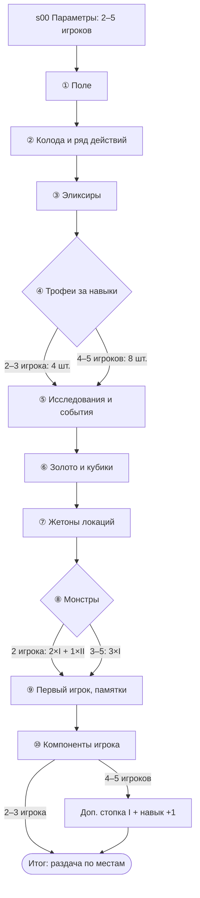
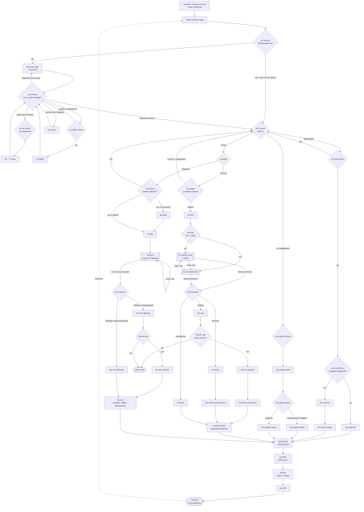

# SPEC: помощник для «Ведьмак: Старый мир»

> Версия 1.0 · 2026-11-03 · статус: утверждено к реализации
> Входные данные: бриф `docs/PLAN.md` (актуальная версия из проекта), книга правил `docs/Vedmak_Stary_Mir__pravila_RUS.pdf` (36 стр.), официальный FAQ/errata GaGa Games, раздел «Базовая игра».
> Если SPEC и книга правил расходятся, **правила главнее**. Ссылка «стр. N» всегда означает страницу печатной/PDF-книги правил.
> Задачи реализации — в `docs/ROADMAP.md`.

---

## Содержание
1. [Обзор и цели](#1-обзор-и-цели)
2. [Глоссарий](#2-глоссарий)
3. [Пользовательские сценарии](#3-пользовательские-сценарии)
4. [Информационная архитектура](#4-информационная-архитектура)
5. [Модель данных](#5-модель-данных)
6. [Движок wizard'а](#6-движок-wizardа)
7. [Граф wizard'а подготовки](#7-граф-wizardа-подготовки)
8. [Граф wizard'а хода](#8-граф-wizardа-хода)
9. [Карточки правил и компоненты справочника](#9-карточки-правил-и-компоненты-справочника)
10. [FAQ](#10-faq)
11. [Изображения](#11-изображения)
12. [Техническая архитектура](#12-техническая-архитектура)
13. [Тестирование и CI](#13-тестирование-и-ci)
14. [План реализации по этапам](#14-план-реализации-по-этапам)
15. [Вне рамок / будущее](#15-вне-рамок--будущее)
16. [Риски и открытые вопросы](#16-риски-и-открытые-вопросы)
17. [Результаты самопроверки](#17-результаты-самопроверки)

---

## 1. Обзор и цели

Статический mobile-first сайт на GitHub Pages: `https://croixani.github.io/witcher-board-game-helper/`. Он помогает играть в базовую «Ведьмак: Старый мир» (русское издание GaGa Games) **на 2–5 игроков**. Сайт состоит из трёх частей:

| Часть | Маршрут | Суть |
|---|---|---|
| Wizard подготовки | `/setup/` | Шаги 1–10 книги правил (+ доп. шаг для 4–5 игроков) с чек-листами, схемой поля с подсветкой зоны и блоками «Не перепутать» |
| Wizard хода | `/turn/` | Ведёт одного игрока через фазы I–III и битву. Задаёт вопросы, показывает правило со страницей. Ресурсы не хранит |
| FAQ | `/faq/` | Пополняемый список вопросов: 1 вопрос = 1 Markdown-файл. Поиск работает offline |

Вспомогательные разделы: справочник компонентов и правил (`/reference/`), страницы карточек правил (`/rules/<id>/`), режим «Сейчас не мой ход» (`/turn/not-my-turn/`).

### 1.1 Решения, зафиксированные в этой SPEC
Решения из брифа (раздел 3) не повторяются. Ниже — новые или изменённые.

| # | Решение | Причина |
|---|---|---|
| D1 | Репозиторий `CroixANI/witcher-board-game-helper`, **публичный**, Pages из GitHub Actions. `site: https://croixani.github.io`, `base: /witcher-board-game-helper` | Ответ пользователя. Pages на Free доступны только публичным репо |
| D2 | Лицензия кода **MIT**. Контент игры под неё не подпадает, это сказано в `NOTICE.md` и README | Ответ пользователя |
| D3 | **Соло-режим полностью исключён**: число игроков 2–5. Схемы не содержат `players: 1` | Ответ пользователя (меняет бриф 6.2/FR-1.1) |
| D4 | **Иллюстрации только собственные**: SVG-иконки компонентов и схема поля. Вырезки и фото из книги правил не публикуются, PDF не коммитится | Ответ пользователя: «своё, лёгковесное», без зависимости от чужих файлов и ссылок |
| D5 | **Нет внешних ссылок на PDF правил** и постраничных deep links. Ссылка на правило — это текст «стр. N» плюс собственная карточка правила (пересказ). В футере правообладатели названы без URL | Пользователь не хочет поддерживать работоспособность ссылок. Единственная внешняя ссылка — `sourceUrl` у FAQ из официального FAQ, она необязательная |
| D6 | **Лимит руки — как в книге (стр. 9):** «если в руке 7 карт, новые не берите». Пункт 25 официального FAQ (вне битвы можно сбросить и взять) **не применяется**. В FAQ он есть как запись `source: house` с пояснением | Ответ пользователя |
| D7 | Острова — **Preact** (`@astrojs/preact`) | См. 12.3 |
| D8 | Конфиг коллекций — `src/content.config.ts` (Content Layer API, Astro ≥ 5) вместо `src/content/config.ts` из брифа. Данные лежат в `src/content/**` | Актуальное API Astro |
| D9 | `docs/PLAN.md` в репозитории заменяется актуальной версией брифа (в задаче M0) | Ответ пользователя |

### 1.2 Расхождения брифа с правилами (исправлено в SPEC)
| Бриф | Книга правил | Где учтено |
|---|---|---|
| Последствия битвы без общего «завершения» | После **любой** битвы участник: щит до максимума, **все** свои карты действий (колода + сброс + рука) замешивает в новую колоду. После битвы с монстром ещё перемешиваются все боевые карты монстров, сбрасываются использованные эликсиры. Значит, фаза III после битвы начинается **с пустой рукой** (стр. 22, 27, 28; пример на стр. 32) | `b-end-monster`, `bw-end`, `p3-discard` |
| Поражение от монстра: монстр остаётся + карта стоимостью 0 | Дополнительно: **взять жетон следа** этого монстра, если у вас нет следа такого типа. В фазе III добрать **на 1 карту меньше** (стр. 26) | `bm-lose` |
| Победа над ведьмаком: «трофей» | Трофей берётся, **только если у нападающего ещё нет ведьмачьего трофея этой школы** (стр. 27) | `bw-win-attacker` |
| Битва начинается сразу | У некоторых монстров есть **условие начала битвы** в особой способности. Пример: архиспора требует сбросить эликсир (стр. 21, 31) | `bm-ability` |
| Фаза III: «обязательно взять карту» | Обязательно, **если возможно**. Если оплатить нельзя — карта не берётся (стр. 19; FAQ п. 26) | `p3-buy` |
| Дейcтвия локаций: «повышение навыка, покер, выслеживание, школы…» | 7 типов действий (стр. 35–36), см. 8.4 | `la-*` |
| 4–5 игроков: доп. шаги внутри шага 8 | Книга: «сначала обычная подготовка, **затем** 2 доп. действия» (стр. 8) | Шаг `s11-extra-4-5` |

---

## 2. Глоссарий

| Термин игры | ID / термин в коде | Примечание |
|---|---|---|
| Игровое поле | `board` | |
| Карта действия / колода карт действий / ряд карт | `action-card` / `action-deck` / `action-row` | Ряд: 6 ячеек. «Левые» (+1) — у колоды, «правая» (−1) — дальняя (стр. 19) |
| Начальные карты действий | `starter-cards` | 10 на школу, символ школы в правом верхнем углу |
| Карта эликсира | `elixir` | Лимит 4 |
| Карта исследования города / окрестностей | `exploration-city` / `exploration-wilds` | |
| Карта события | `event` | Пронумерованы, **не перемешивать** |
| Задание | `quest` | Карта исследования с ключевым словом «Задание» |
| Задание на выслеживание | `hunt-quest` | Жетон локации лицом вверх + 1 золото (стр. 36) |
| Трофей за навык | `skill-trophy` | 8 карт, 2 на навык |
| Ведьмачий трофей | `witcher-trophy` | 4 карты на школу |
| Жетон трофеев / шкала трофеев | `trophy-marker` / `trophy-track` | Деления определяют истощение и награду за победу над ведьмаком |
| Жетон локации | `location-token` | Типы местности: `forest` / `mountain` / `water` |
| Жетон следа | `trail-token` | Жетон локации лицом вниз рядом с игроком |
| Жетон монстра / карта монстра / боевая карта монстра | `monster-token` / `monster-card` / `monster-battle-card` | Уровни `I`/`II`/`III` |
| Жетон закрытой корчмы | `closed-tavern` | |
| Золото | `gold` | |
| Кубики для покера | `poker-dice` | 2 набора по 5 |
| Памятка | `reference-card` | По действиям и по битвам |
| Планшет игрока | `player-board` | |
| Школа | `school`: `wolf` / `griffin` / `bear` / `cat` / `viper` | Волк, Грифон, Медведь, Кот, Змея |
| Навыки | `skill`: `combat` / `defense` / `alchemy` / `specialization` | Сражение, защита, алхимия, специализация |
| Уровень ведьмака | `witcher-level` | Не понижается |
| Щит | `shield` | ≤ уровень защиты |
| Запас жизни | `life-pool` | |
| Потеря сознания | `unconscious` | |
| Истощение | `exhaustion` | Убрать N карт из игры |
| Убрать из игры | `remove-from-game` | ≠ сбросить |
| Комбинация / связь | `combo` / `link` | |
| Удар / укус | `attack-strike` / `attack-bite` | Типы атаки монстра |
| Ставка | `bet` | Только в битве ведьмаков, ≥ 3 игроков |
| Активный игрок | `active` | Тот, кто ходит |
| Контролирующий монстра | `monster-controller` | Игрок справа от активного |
| Фазы | `phase1` / `phase2` / `battle` / `phase3` | Плюс `setup`, `general` для FAQ |
| Параметры партии | `params.players` (2–5), `params.school` | |
| Флаги хода | `flags.*` | Факты о текущем ходе, не ресурсы (см. 6.4) |

---

## 3. Пользовательские сценарии

### Подготовка
- **US-S1.** Как хозяин партии, я выбираю число игроков (2–5) и вижу только нужные шаги и варианты.
- **US-S2.** На каждом шаге я вижу чек-лист, иконки нужных компонентов («как выглядит рубашка карт исследования окрестностей») и схему поля с подсвеченной зоной.
- **US-S3.** Я вижу «⚠ Не перепутать», например «колоду событий не перемешивать».
- **US-S4.** В конце я вижу таблицу «кто сколько карт и золота берёт» и порядок выбора планшетов.
- **US-S5.** Если телефон заблокировался или я случайно перезагрузил страницу, wizard продолжает с того же шага.
- **US-S6** (низкий приоритет). Случайный выбор первого игрока.

### Ход
- **US-T1.** Один раз за партию я выбираю число игроков и свою школу. Специализация моей школы всегда под рукой.
- **US-T2.** В фазе I wizard спрашивает «Перемещаетесь?», показывает 4 способа перемещения и что можно сделать в новой локации. Он напоминает, что в стартовой локации действовать нельзя.
- **US-T3.** В фазе II я выбираю одно действие, wizard ведёт меня по ветке и проверяет условия вопросами.
- **US-T4.** В битве у меня кнопки «Следующий ход» и «Битва окончена». При выборе исхода я получаю точный чек-лист последствий.
- **US-T5.** В фазе III wizard подсказывает, сколько добрать (с учётом «−1 за поражение»), модификаторы стоимости ячеек.
- **US-T6.** «Ход завершён» сбрасывает wizard к началу: телефон готов к моему следующему ходу.
- **US-T7.** На любом шаге я могу раскрыть полное правило (стр. N) и открыть FAQ по текущей фазе.
- **US-T8.** Панель «Не забудь» доступна с любого шага.

### Не мой ход
- **US-N1.** Пока ходят другие, я открываю «Сейчас не мой ход» и вижу, что от меня может понадобиться. Например: прочитать карту исследования или события за игрока слева, управлять монстром, выбрать тип атаки, сделать ставку, сыграть в покер, сыграть за горожан, защищаться в битве.

### FAQ
- **US-F1.** Я ищу «медитация последний трофей» и получаю ответ offline.
- **US-F2.** Из wizard'а кнопка «?» открывает FAQ, уже отфильтрованный по фазе.
- **US-F3** (владелец). После партии я создаю файл по шаблону прямо в веб-интерфейсе GitHub, CI проверяет схему, и сайт пересобирается.
- **US-F4** (игрок). Я открываю Issue Form «Новый вопрос в FAQ», владелец превращает его в файл.

---

## 4. Информационная архитектура

### 4.1 Маршруты
Все пути относительно `base` (`/witcher-board-game-helper/`). `trailingSlash: 'always'`.

| Маршрут | Страница | Остров |
|---|---|---|
| `/` | Главная: 3 большие кнопки (Подготовка, Мой ход, Не мой ход) + ссылки на Справочник и FAQ | — |
| `/setup/` | Wizard подготовки | `WizardIsland graph="setup"` |
| `/turn/` | Wizard хода | `WizardIsland graph="turn"` |
| `/turn/not-my-turn/` | Список ситуаций «не мой ход» (аккордеон) | — (`<details>`) |
| `/reference/` | Галерея компонентов + фильтр (Карты / Жетоны / Прочее), специализации школ, действия локаций | `ReferenceFilter` (опционально, работает и без JS) |
| `/rules/` | Список всех карточек правил по группам | — |
| `/rules/[id]/` | Одна карточка правила | — |
| `/faq/` | Список FAQ + поиск + фильтры | `FaqSearch` |
| `/faq/[slug]/` | Один вопрос (канонический URL), на списке — якорь `#slug` | — |
| `/about/` | О проекте, правообладатели, лицензия, как помочь | — |

### 4.2 Навигация
- Нижний tab bar (mobile, ≤ 768 px): **Подготовка · Ход · Справка · FAQ**. На ≥ 768 px он становится верхней навигацией.
- В wizard'ах закреплён верхний бар: «← Назад», заголовок фазы, «⟲ Заново» (с подтверждением), «⚑ Не забудь» (bottom sheet).
- Хлебные крошки не нужны.

### 4.3 Wireframes (mobile, 375 px)

**Шаг wizard'а подготовки**
```
┌─────────────────────────────┐
│ ← Назад   Подготовка 5/12  ⟲│
├─────────────────────────────┤
│ ▓▓▓▓▓▓▓░░░░░  (прогресс)    │
│ ⑤ Карты исследования        │
│   и событий          стр. 6 │
│ ┌─────────────────────────┐ │
│ │ [схема поля, зона ⑤     │ │
│ │  подсвечена, пульс]     │ │
│ └─────────────────────────┘ │
│ ☐ События: НЕ перемешивать, │
│   по номерам на рубашке     │
│ ☐ Город: перемешать отдельно│
│ ☐ Окрестности: отдельно     │
│ ┌ Компоненты ─────────────┐ │
│ │ [▭ город] [▭ окр.] [▭ соб]│
│ └─────────────────────────┘ │
│ ⚠ Не перепутать: …          │
│ ▸ Правило полностью (стр. 6)│
├─────────────────────────────┤
│        [ Далее → ]          │
└─────────────────────────────┘
```

**Узел-выбор wizard'а хода**
```
┌─────────────────────────────┐
│ ← Назад   Фаза II       ⚑  ⟲│
├─────────────────────────────┤
│ Выберите ОДНО действие      │
│ После выбора другие         │
│ недоступны до конца хода.   │
│ ┌─────────────────────────┐ │
│ │ ⚔ Битва                 │ │
│ │   монстр или ведьмак    │ │
│ │   в вашей локации       │ │
│ └─────────────────────────┘ │
│ ┌─────────────────────────┐ │
│ │ ☯ Медитация             │ │
│ └─────────────────────────┘ │
│ ┌─────────────────────────┐ │
│ │ 🔍 Исследование          │ │
│ └─────────────────────────┘ │
│ ▸ Правило: Фаза II (стр. 15)│
│ [?] FAQ по фазе II          │
│ [Школа: Медведь ▸]          │
└─────────────────────────────┘
```

**Цикл битвы**
```
┌─────────────────────────────┐
│ ← Назад  Битва · ход 3   ⚑ ⟲│
├─────────────────────────────┤
│ Ходит: ВЫ (ведьмак)         │
│ 1 ☐ Эффекты: эликсиры (≤ N  │
│     за битву), специализ.,  │
│     карты перед вами        │
│ 2 ☐ Комбинация ≥ 1 карты    │
│ 3 ☐ Урон → щит → прочее     │
│ 4 ☐ Добор = сражение ± эфф. │
│ ▸ Подробно (стр. 22–24)     │
├─────────────────────────────┤
│ [Ход монстра →] [Битва оконч.]│
└─────────────────────────────┘
```

### 4.4 Компоненты UI (Astro / Preact)
| Компонент | Тип | Назначение |
|---|---|---|
| `BaseLayout.astro` | Astro | `<head>`, тема, tab bar, футер с правообладателями |
| `RuleCard` | Astro + Preact-версия | Свёрнутая карточка правила: заголовок, «стр. N», тело (Markdown → HTML на этапе сборки) |
| `ComponentChip` / `ComponentCard` | Astro + Preact | SVG-иконка, название, «как отличить» |
| `BoardSchematic` | Preact (используется в острове) | Inline SVG схемы поля, подсветка `zones[]` |
| `WizardIsland` | Preact island | Рендер узла, история, сохранение, панель «Не забудь» |
| `ChecklistStep`, `ChoiceStep`, `QuestionStep`, `InfoStep`, `LoopStep`, `EndStep` | Preact | Рендер по типу узла |
| `SchoolBadge` | Preact | Карточка специализации выбранной школы (раскрывается) |
| `ReminderSheet` | Preact | «Не забудь», bottom sheet |
| `FaqSearch` | Preact island | Pagefind UI-less API + фильтры |

---

## 5. Модель данных

### 5.1 Структура контента
```
src/content/
├─ rules/*.md               # карточки правил (id = имя файла)
├─ components/*.yaml        # компоненты справочника (1 файл = 1 компонент)
├─ schools/*.yaml           # 5 школ + специализации
├─ location-actions/*.yaml  # 7 типов действий локаций
├─ setup/*.md               # шаги wizard'а подготовки (1 файл = 1 узел)
├─ turn/*.yaml              # граф wizard'а хода: 1 файл = подграф (массив узлов)
├─ reminders/*.yaml         # пункты панели «Не забудь»
├─ not-my-turn/*.md         # ситуации «Сейчас не мой ход»
└─ faq/*.md                 # 1 вопрос = 1 файл; _template.md исключён из коллекции
```

### 5.2 `src/content.config.ts` (Zod-схемы)
```ts
import { defineCollection, reference } from 'astro:content';
import { glob } from 'astro/loaders';
import { z } from 'astro/zod';

// ── общие типы ────────────────────────────────────────────
export const Page = z.number().int().min(1).max(36);           // стр. книги правил
export const Pages = z.union([Page, z.array(Page).nonempty()]);
export const Expansion = z.enum(['base']).default('base');      // задел под дополнения
export const Phase = z.enum(['setup', 'phase1', 'phase2', 'battle', 'phase3', 'general']);
export const PlayerCount = z.number().int().min(2).max(5);
export const Id = z.string().regex(/^[a-z0-9]+(-[a-z0-9]+)*$/);  // kebab-case

/** Условие показа узла / варианта / перехода. Все поля через AND, массив = OR значений. */
export const Condition = z.object({
  players: z.array(PlayerCount).nonempty().optional(),
  flags: z.record(z.string(), z.boolean()).optional(),          // { lostBattle: true }
  missingParam: z.enum(['players', 'school']).optional(),      // параметр ещё не задан
}).strict();

// ── карточки правил ──────────────────────────────────────
const rules = defineCollection({
  loader: glob({ pattern: '**/*.md', base: './src/content/rules' }),
  schema: z.object({
    title: z.string().min(3),
    page: Pages,
    group: z.enum(['basics', 'phase1', 'phase2', 'battle', 'phase3', 'trophies',
                   'location-actions', 'schools', 'setup']),
    summary: z.string().max(200),            // 1 строка для свёрнутого состояния
    important: z.boolean().default(false),   // красный блок «Важно» в книге
    related: z.array(reference('rules')).default([]),
    expansion: Expansion,
  }).strict(),
});

// ── компоненты ───────────────────────────────────────────
const components = defineCollection({
  loader: glob({ pattern: '**/*.yaml', base: './src/content/components' }),
  schema: z.object({
    name: z.string(),
    kind: z.enum(['card', 'token', 'board', 'misc']),
    count: z.number().int().positive(),
    perPlayer: z.boolean().default(false),   // «в каждом наборе игрока»
    icon: z.string().regex(/^[a-z0-9-]+\.svg$/),   // файл в src/assets/svg/components/
    howToTell: z.string(),                   // «как отличить»
    confusedWith: z.array(reference('components')).default([]),
    usedIn: z.array(z.string()).default([]), // id узлов setup/turn — проверяет validate-content
    rules: z.array(reference('rules')).default([]),
    rulesPage: Pages,
    expansion: Expansion,
  }).strict(),
});

// ── школы ────────────────────────────────────────────────
const schools = defineCollection({
  loader: glob({ pattern: '**/*.yaml', base: './src/content/schools' }),
  schema: z.object({
    name: z.string(),                        // «Школа Волка»
    specialization: z.string(),              // «Владение мечом»
    effect: z.string(),                      // текст с плейсхолдерами (1–2)
    timing: z.string(),                      // «Один раз за битву: …»
    page: Pages,
    color: z.string().regex(/^#[0-9a-f]{6}$/i), // цвет подставки/акцента
    expansion: Expansion,
  }).strict(),
});

// ── действия локаций ─────────────────────────────────────
const locationActions = defineCollection({
  loader: glob({ pattern: '**/*.yaml', base: './src/content/location-actions' }),
  schema: z.object({
    title: z.string(),
    iconHint: z.string(),                    // как выглядит символ на поле (словами)
    icon: z.string().regex(/^[a-z0-9-]+\.svg$/),
    steps: z.array(z.string()).nonempty(),
    rule: reference('rules'),
    page: Pages,
  }).strict(),
});

// ── узлы wizard'ов (общая часть) ─────────────────────────
const Next = z.union([
  Id,                                                           // безусловный переход
  z.array(z.object({ when: Condition.optional(), to: Id })).nonempty(), // первый подходящий
]);
const Option = z.object({
  label: z.string(),
  hint: z.string().optional(),
  next: Id,
  showIf: Condition.optional(),
  set: z.record(z.string(), z.boolean()).optional(),            // установить флаги хода
  setParam: z.object({ key: z.enum(['players', 'school']), value: z.union([z.number(), z.string()]) }).optional(),
}).strict();
const ChecklistItem = z.object({
  text: z.string(),
  showIf: Condition.optional(),
  rule: reference('rules').optional(),
}).strict();
const NodeBase = {
  id: Id,
  title: z.string(),
  phase: Phase,
  pages: Pages,                                                 // ОБЯЗАТЕЛЬНО: стр. правил
  rules: z.array(reference('rules')).default([]),
  components: z.array(reference('components')).default([]),
  note: z.string().optional(),                                  // короткий подзаголовок
  warning: z.string().optional(),                               // «⚠ Не перепутать»
  showIf: Condition.optional(),                                 // узел пропускается, если false
  faqPhase: Phase.optional(),                                   // фильтр кнопки «?»; по умолчанию = phase
};
export const WizardNode = z.discriminatedUnion('type', [
  z.object({ ...NodeBase, type: z.literal('step'),
    checklist: z.array(ChecklistItem).nonempty(), zones: z.array(z.string()).default([]), next: Next }).strict(),
  z.object({ ...NodeBase, type: z.literal('info'), body: z.string().optional(), next: Next }).strict(),
  z.object({ ...NodeBase, type: z.literal('choice'), options: z.array(Option).min(2) }).strict(),
  z.object({ ...NodeBase, type: z.literal('question'), question: z.string(),
    yes: Option.omit({ label: true }).extend({ label: z.string().default('Да') }),
    no: Option.omit({ label: true }).extend({ label: z.string().default('Нет') }) }).strict(),
  z.object({ ...NodeBase, type: z.literal('loop'),
    counterKey: z.string(),                                     // 'battleTurn'
    actorLabel: z.string().optional(),                          // «Ходит: {actor}»
    checklist: z.array(ChecklistItem).nonempty(),
    options: z.array(Option.extend({ increment: z.boolean().default(false) })).min(2) }).strict(),
  z.object({ ...NodeBase, type: z.literal('end'), resetTo: Id.optional(),
    outcome: z.enum(['turn-complete', 'game-won', 'setup-complete']) }).strict(),
]);

// ── подготовка: 1 файл = 1 узел, тело Markdown = подробный текст ──
const setup = defineCollection({
  loader: glob({ pattern: '**/*.md', base: './src/content/setup' }),
  schema: z.object({
    order: z.number(),                       // порядок; переходы по умолчанию — к следующему order
    node: WizardNode,
  }).strict(),
});

// ── ход: 1 файл = подграф ────────────────────────────────
const turn = defineCollection({
  loader: glob({ pattern: '**/*.yaml', base: './src/content/turn' }),
  schema: z.object({
    subgraph: z.enum(['start', 'phase1', 'location-actions', 'phase2', 'battle-monster', 'battle-witcher', 'phase3']),
    entry: Id,
    nodes: z.array(WizardNode).nonempty(),
  }).strict(),
});

// ── «Не забудь» ──────────────────────────────────────────
const reminders = defineCollection({
  loader: glob({ pattern: '**/*.yaml', base: './src/content/reminders' }),
  schema: z.object({
    text: z.string(), order: z.number(), rule: reference('rules'), page: Pages,
    phases: z.array(Phase).default(['general']),
  }).strict(),
});

// ── «Сейчас не мой ход» ─────────────────────────────────
const notMyTurn = defineCollection({
  loader: glob({ pattern: '**/*.md', base: './src/content/not-my-turn' }),
  schema: z.object({
    title: z.string(), order: z.number(), trigger: z.string(),
    showIf: Condition.optional(), rules: z.array(reference('rules')).nonempty(), pages: Pages,
  }).strict(),
});

// ── FAQ ──────────────────────────────────────────────────
const faq = defineCollection({
  loader: glob({ pattern: ['**/*.md', '!_template.md'], base: './src/content/faq' }),
  schema: z.object({
    question: z.string().min(10).endsWith('?'),
    tags: z.array(z.string()).nonempty(),
    phase: Phase,
    source: z.enum(['rulebook', 'official-faq', 'house']),
    page: Page.optional(),
    sourceRef: z.string().optional(),        // «Офиц. FAQ, Базовая игра, п. 8»
    sourceUrl: z.string().url().optional(),
    rules: z.array(reference('rules')).default([]),
    updated: z.coerce.date(),
    expansion: Expansion,
  }).strict().refine(f => f.source !== 'rulebook' || f.page, { message: 'rulebook → нужен page' }),
});

export const collections = { rules, components, schools, locationActions, setup, turn, reminders, notMyTurn, faq };
```

**Что Zod не проверяет (делает `scripts/validate-content.ts`, запускается в `npm test` и в `prebuild`):**
- уникальность `id` узлов в графе;
- что каждый `next` / `options[].next` / `resetTo` ссылается на существующий узел;
- что `components[].usedIn` ссылаются на существующие узлы;
- что `zones` есть в `src/data/board-zones.ts`;
- что `icon` есть на диске;
- граф-инварианты из раздела 13.2.

`reference('rules')` и `reference('components')` Astro проверяет сам: битая ссылка ломает сборку.

### 5.3 Примеры файлов

`src/content/rules/meditation.md`
```md
---
title: "Медитация"
page: 15
group: phase2
summary: "Трофей за навык 5-го уровня, если он есть в колоде и у вас его ещё нет."
important: false
related: [last-trophy-meditation, exhaustion]
---
Медитация — одно из трёх действий фазы II. Условия (все сразу):
1. Хотя бы один навык на 5-м уровне.
2. В колоде трофеев за навыки есть трофей за **этот** навык.
3. У вас ещё нет трофея за этот навык.

Возьмите трофей, положите под планшет, поднимите жетон трофеев на 1 и испытайте истощение.
За одну медитацию — только один трофей.
```

`src/content/components/exploration-wilds.yaml`
```yaml
name: "Карты исследования окрестностей"
kind: card
count: 36
icon: card-back-exploration-wilds.svg
howToTell: "Зелёная рубашка с пейзажем. Не путать с городом (серая, со зданием) и событиями (коричневая, с книгой)."
confusedWith: [exploration-city, event-card]
usedIn: [s05-exploration-events, p2-explore-where]
rules: [exploration]
rulesPage: [4, 6, 16]
```

`src/content/schools/bear.yaml`
```yaml
name: "Школа Медведя"
specialization: "Доспехи"
timing: "Один раз за битву, автоматически"
effect: "Если в ваш ход битвы ваш щит = 0: щит +N (0–2) и возьмите M (1–2) карт. Значения — по текущему уровню специализации."
page: 34
color: "#3d6fb6"
```

`src/content/location-actions/school-training.yaml`
```yaml
title: "Тренировка в школе"
iconHint: "Символы пяти школ и «−2, −3, −4, −5»"
icon: loc-school-training.svg
steps:
  - "Выберите навык: сражение, защиту или алхимию. В родной школе можно выбрать специализацию."
  - "Заплатите золото: текущее значение навыка + 1. Нет золота — нельзя."
  - "Навык +1 (только на 1 уровень; можно выше уровня ведьмака)."
rule: loc-school-training
page: 36
```

`src/content/setup/s05-exploration-events.md`
```md
---
order: 5
node:
  id: s05-exploration-events
  type: step
  title: "⑤ Карты исследования и событий"
  phase: setup
  pages: 6
  rules: [setup-exploration-events]
  components: [event-card, exploration-city, exploration-wilds]
  zones: [z-exploration-decks]
  warning: "Колоду событий НЕ перемешивать: карты лежат строго по номерам на рубашке."
  checklist:
    - text: "Колоду событий (коричневая рубашка, книга) положите лицом вниз по порядку номеров"
    - text: "Карты исследования города (серая) перемешайте отдельно → на поле"
    - text: "Карты исследования окрестностей (зелёная) перемешайте отдельно → на поле"
  next: s06-gold-dice
---
Колода событий используется только по номеру из задания (стр. 17), поэтому порядок важен.
```

`src/content/turn/phase2.yaml` (фрагмент)
```yaml
subgraph: phase2
entry: p2-choose
nodes:
  - id: p2-choose
    type: choice
    title: "Фаза II: выберите ОДНО действие"
    note: "Выбрав действие, другие в этот ход выполнять нельзя."
    phase: phase2
    pages: 15
    rules: [phase2-overview]
    options:
      - { label: "⚔ Битва", hint: "Монстр или ведьмак в вашей локации", next: b-target }
      - { label: "☯ Медитация", hint: "Навык на 5-м уровне", next: p2-med-check }
      - { label: "🔍 Исследование", hint: "Доступно в любой локации", next: p2-explore-where }
```

`src/content/faq/meditation-last-trophy.md`
```md
---
question: "Можно ли выиграть, получив последний трофей медитацией?"
tags: [трофеи, медитация, победа]
phase: phase2
source: rulebook
page: 15
rules: [last-trophy-meditation]
updated: 2026-11-03
---
Нет. Последний трофей нужно получить в битве. Если медитация дала бы победный трофей, вы его
забираете (эффект работает), но жетон трофеев не двигается и истощения нет (стр. 15, 29).
```

`src/content/reminders/hand-limit.yaml`
```yaml
text: "В руке максимум 7 карт: если уже 7 — новые не берите."
order: 10
rule: hand-limit
page: 9
phases: [general]
```

---

## 6. Движок wizard'а

`src/lib/wizard-engine.ts` — чистый TypeScript без зависимостей от UI и Astro. Его покрывают unit-тесты.

### 6.1 Типы
```ts
export type Params = { players?: 2 | 3 | 4 | 5; school?: School };
export type Flags = Record<string, boolean>;
export type WizardState = {
  v: 1;                       // версия формата state
  graph: 'setup' | 'turn';
  params: Params;             // переживают «Ход завершён»
  current: string;            // id узла
  history: string[];          // стек для «Назад»
  flags: Flags;               // сбрасываются на «Ход завершён»
  counters: Record<string, number>; // battleTurn и т. п.
  checked: Record<string, number[]>; // отмеченные пункты чек-листов по узлам
  updatedAt: number;
};
export type Graph = { entry: string; nodes: Map<string, WizardNode> };

export function buildGraph(nodes: WizardNode[], entry: string): Graph;
export function evaluate(cond: Condition | undefined, s: WizardState): boolean;
export function resolveNext(next: Next, s: WizardState): string;        // первый when=true
export function visibleOptions(node, s): Option[];
export function choose(s, optionIndex): WizardState;                    // set/setParam/increment
export function advance(s): WizardState;                                // step/info → next
export function back(s): WizardState;                                   // pop history (флаги откатываются: храним снапшоты)
export function resetTurn(s): WizardState;                              // current=entry, flags={}, counters={}, history=[]
export function restartAll(s): WizardState;                             // + params={}
export function skipHidden(s): WizardState;                             // пропуск узлов с showIf=false по их next
```

### 6.2 Типы узлов
| Тип | Отображение | Переход |
|---|---|---|
| `step` | Заголовок, чек-лист (галочки не блокируют «Далее»), зоны на схеме, компоненты | `next` (строка или условный список) |
| `info` | Текст + правило | `next` |
| `choice` | 2+ крупные кнопки-карточки; варианты с `showIf=false` скрыты | `options[i].next`, может ставить флаги / параметр |
| `question` | Вопрос и кнопки «Да» / «Нет» | `yes.next` / `no.next` |
| `loop` | Чек-лист + счётчик «ход N» + «Ходит: …» | Варианты, `increment: true` увеличивает `counters[counterKey]` |
| `end` | Итог + кнопка «Начать заново» / «Следующий ход» | `resetTo` → `resetTurn()` |

### 6.3 Условия
Только декларативные (`Condition`), без `eval`:
- `players: [3,4,5]` — число игроков входит в список;
- `flags: { pokerPlayed: true }` — значения флагов совпадают;
- `missingParam: 'school'` — параметр ещё не задан (так `t-params`/`t-school` показываются один раз за партию);
- несколько полей объединяются через AND.

Узел с ложным `showIf` пропускается: движок идёт по его `next` и **не кладёт его в history**.

### 6.4 Флаги хода (не ресурсы)
Флаги — это факты о текущем ходе. Их ставит выбор игрока, нужны они только для подсказок и ветвления:

| Флаг | Где ставится | Где используется |
|---|---|---|
| `moved` | `p1-move-how` | Подсказка в `p1-arrived` |
| `pokerPlayed` | `p1-poker` | Предупреждение в `bw-check` |
| `lostBattle` | `bm-lose`, `bw-win-defender` | `p3-draw`: «доберите на 1 меньше» |
| `afterBattle` | `b-end-monster`, `bw-end` | `p3-discard`: «рука пуста, сбрасывать нечего» |
| `wasDefender` | — (зарезервировано для «не мой ход») | |

Золото, навыки, карты и трофеи **не хранятся**.

### 6.5 Сохранение
- `localStorage` key: `twow:v1:setup`, `twow:v1:turn`. Пишем на каждый переход, читаем при монтировании.
- Все обращения — через `safeStorage` (try/catch). Если хранилище недоступно, wizard работает в памяти и показывает тихий баннер «прогресс не сохранится».
- Если `v` не совпадает или в state есть неизвестный `current`, state сбрасывается к `entry`. Параметры по возможности сохраняются.
- Ключ `twow:v1:params` общий для обоих wizard'ов: число игроков, выбранное в подготовке, подставляется в ход.

### 6.6 «Назад» и сброс
- `back()` восстанавливает предыдущий узел и **снапшот** flags/counters на момент входа в него. History хранит `{id, flags, counters}`, глубина ≤ 200.
- «⟲ Заново» с подтверждением → `resetTurn()` (ход) или `restartAll()` (подготовка).
- `end` типа `turn-complete` → экран «Ход завершён. Передайте ход по часовой стрелке» + кнопка «Мой следующий ход» → `resetTurn()`.

### 6.7 Доступность движка
- Фокус переносится на заголовок нового узла (`tabindex=-1`), смена узла объявляется через `aria-live="polite"`.
- Варианты выбора — `<button>`, чек-лист — нативные `<input type=checkbox>`.

---

## 7. Граф wizard'а подготовки

Линейный граф с условными пунктами: 13 узлов, ветвлений нет, условия только по `players`. Колонка «2 / 3 / 4 / 5» показывает, что меняется.

| # | id | Шаг | Чек-лист (суть) | 2 | 3 | 4 | 5 | Стр. | Зоны схемы | Правила |
|---|---|---|---|---|---|---|---|---|---|---|
| 0 | `s00-params` | Параметры партии (`choice` → `setParam players`) | Число игроков 2–5. Подсказка: «Первую партию лучше играть вдвоём или втроём; на 4–5 все должны знать правила» | | | | | 6, 8 | — | `setup-overview` |
| 1 | `s01-board` | ① Игровое поле | Разложить поле в центре стола | = | = | = | = | 6 | `z-board` | `setup-overview` |
| 2 | `s02-action-row` | ② Колода и ряд карт действий | 1) Перемешать все карты действий **кроме начальных**. 2) Открывать по одной, пока не будет 3 карты стоимостью 0 (стоимость — правый нижний угол) → в 3 **правые** ячейки (дальние от колоды) в случайном порядке. 3) Остальные открытые замешать обратно, колоду — на место слева от ряда. 4) Ещё 3 карты → в 3 **левые** ячейки | = | = | = | = | 6, 19 | `z-action-deck`, `z-action-row` | `setup-action-row`, `card-cost` |
| 3 | `s03-elixirs` | ③ Колода эликсиров | Перемешать 28 эликсиров, лицом вниз на место | = | = | = | = | 6 | `z-elixir-deck` | `elixirs` |
| 4 | `s04-skill-trophies` | ④ Трофеи за навыки | **2–3:** по 1 трофею на каждый навык (сражение, защита, алхимия, специализация) = 4 карты, остальные 4 в коробку. **4–5:** все 8 | 4 шт. | 4 шт. | 8 шт. | 8 шт. | 6 | `z-skill-trophies` | `setup-skill-trophies` |
| 5 | `s05-exploration-events` | ⑤ Исследования и события | События **не перемешивать** (по номерам). Город и окрестности перемешать **по отдельности** | = | = | = | = | 6 | `z-exploration-decks` | `setup-exploration-events` |
| 6 | `s06-gold-dice` | ⑥ Золото и кубики | Все жетоны золота и 2 набора кубиков рядом с полем | = | = | = | = | 6 | `z-supply` | — |
| 7 | `s07-location-tokens` | ⑦ Жетоны локаций | 1) Рассортировать 18 жетонов на 3 стопки: лес, горы, вода. 2) Каждую перемешать, лицом вниз рядом с полем. 3) По 1 из каждой стопки **лицом вверх** на 3 места у ячеек монстров | = | = | = | = | 6 | `z-location-stacks`, `z-monster-slots` | `location-tokens` |
| 8 | `s08-monsters` | ⑧ Монстры | 8.1 Карты монстров: 3 колоды по уровню, **лицом вверх**. 8.2 Жетоны монстров: 3 стопки по уровню (римская цифра на рубашке), перемешать, лицом вниз. 8.3 Взять жетоны **не переворачивая**: **2 игрока → 2×I + 1×II, первый игрок решает, к какой локации II**; **3–5 → 3×I**. По одному к каждому открытому жетону локации. 8.4 Перевернуть. 8.5 Каждого монстра — в локацию с номером жетона рядом (тип местности на поле не закрывать). 8.6 Карту каждого монстра — в ячейку под его жетоном локации. 8.7 Перемешать 20 боевых карт монстров → колода рядом с полем | 2×I+1×II | 3×I | 3×I | 3×I | 6–7 | `z-monster-supply`, `z-monster-slots`, `z-map`, `z-monster-battle-deck` | `setup-monsters` |
| 9 | `s09-first-player` | ⑨ Первый игрок и памятки | Выбрать первого игрока («кто недавно читал книгу о ведьмаках» или случайно — кнопка 🎲, FR-1.4). Каждому: памятка по действиям + памятка по битвам | = | = | = | = | 7 | — | `setup-first-player` |
| 10 | `s10-player-components` | ⑩ Компоненты игрока | 10.1 Выбор планшетов: начиная **справа от первого** и **против часовой**: перемешать невыбранные лицом вниз, взять 2, оставить 1. Первый игрок выбирает последним (при 5 — берёт последний). Вариант: по договорённости или случайно. 10.2 Жетон трофеев на нижнее деление шкалы. 10.3 Фигурка + подставка цвета школы → в локацию своей школы. 10.4 5 кубов: уровень ведьмака + 4 навыка на нижние деления. 10.5 Ведьмачьи трофеи своей школы **по числу оппонентов** под верх планшета. 10.6 Маркер щита на 1. 10.7 10 начальных карт (символ школы справа вверху) перемешать → колода слева от планшета. 10.8 Ресурсы по месту (таблица 7.1). 10.9 Неиспользованное — в коробку | 1 трофей | 2 | 3 | 4 | 7–8 | `z-trophy-track`, `z-map`, `z-player-area` | `setup-player-components`, `setup-start-resources` |
| 11 | `s11-extra-4-5` | Доп. действия для 4–5 игроков (`showIf players:[4,5]`) | 1) **Доп. стопка монстров I**: 4 игрока → 1 случайный жетон I (не переворачивать), 5 игроков → 2. Лицом вниз рядом с зоной карт монстров. 2) Каждый повышает 1 навык на 1, по часовой начиная с первого. ⚠ Защита → сразу щит +1; алхимия → сразу 1 эликсир | — | — | 1 жетон | 2 жетона | 8, 10, 26 | `z-monster-slots`, `z-player-area` | `extra-monster-stack`, `defense-shield`, `alchemy-elixir` |
| 12 | `s12-summary` | Итог: раздача по местам (`end`, `setup-complete`) | Таблица 7.1 для выбранного числа игроков, порядок выбора планшетов (7.2), кнопка «Перейти к ходу →» | | | | | 7–8 | — | `setup-start-resources` |

### 7.1 Стартовые ресурсы (стр. 8) — `src/data/start-resources.ts`
| Место | 2 игрока | 3 игрока | 4 игрока | 5 игроков |
|---|---|---|---|---|
| 1-й | 3 карты, 2 золота | 3 карты, 2 золота | 2 карты, 4 золота | 2 карты, 5 золота |
| 2-й | 5 карт, 4 золота | 4 карты, 4 золота | 3 карты, 5 золота | 3 карты, 5 золота |
| 3-й | — | 5 карт, 6 золота | 4 карты, 6 золота | 4 карты, 5 золота |
| 4-й | — | — | 5 карт, 7 золота | 4 карты, 7 золота |
| 5-й | — | — | — | 5 карт, 7 золота |

Карты берутся из своей перемешанной колоды и становятся рукой. Таблица хранится как TS-константа, а не в контенте: это данные для вычислений. Unit-тест сверяет её с этой SPEC.

### 7.2 Порядок выбора планшетов
Пусть места пронумерованы по часовой: 1 — первый игрок. Порядок выбора: справа от первого и против часовой, то есть места **N, N−1, …, 2, 1**. Пример для 4 игроков: 4 → 3 → 2 → 1. Экран показывает это как список «Сначала выбирает игрок справа от первого…».

### 7.3 Mermaid


---

## 8. Граф wizard'а хода

### 8.1 Обзор (Mermaid)


### 8.2 Узлы: старт и фаза I (`turn/start.yaml`, `turn/phase1.yaml`)

| id | Тип | Текст / варианты | Переходы | Правила | Стр. |
|---|---|---|---|---|---|
| `t-params` | choice | «Сколько игроков?» 2/3/4/5 (`setParam players`). Пропускается (`showIf`), если `players` уже задан, в т. ч. из подготовки | → `t-school` | `turn-structure` | 9, 12 |
| `t-school` | choice | «Ваша школа?» Волк / Грифон / Медведь / Кот / Змея (`setParam school`). Пропускается, если задана | → `t-start` | `specializations` | 34–35 |
| `t-start` | info | «Ваш ход. Вы в локации, где закончили прошлый ход: действовать в ней нельзя, пока не уйдёте и не вернётесь». Бейдж школы | → `p1-move-q` | `turn-structure`, `phase1-actions-after-move` | 12, 13 |
| `p1-move-q` | choice | «Фаза I. Перемещаетесь?» — «Да» / «Нет, сразу к фазе II» | `p1-move-how` / `p2-choose` | `phase1-overview` | 12 |
| `p1-move-how` | step | Перемещение в **соседнюю** локацию (по дороге или морскому пунктиру), сбросив: ☐ 1 карту с символом местности этой локации, **или** ☐ 2 любые карты, **или** ☐ 1 любую карту + 1 золото, **или** ☐ 1 карту-джокер (тройной символ). Иконки 4 способов. `set moved` | → `p1-arrived` | `movement`, `adjacency` | 12 |
| `p1-arrived` | choice | «Вы в новой локации. Всё необязательно, в любом порядке». Варианты: Действие локации (hint: 1 раз за ход на локацию, даже если вернулись) · Покер с ведьмаком (hint: ≥1 золота у обоих) · Выполнить задание · Переместиться ещё · Закончить фазу I. Note: «Монстр и другие ведьмаки не мешают действиям» | `p1-loc-action` / `p1-poker-check` / `p1-quest` / `p1-move-how` / `p2-choose` | `phase1-location-actions`, `phase1-next` | 13 |
| `p1-loc-action` | choice | «Какой символ действия под локацией?» 7 вариантов с иконками (8.4) | `la-*` | `location-actions` | 35–36 |
| `p1-poker-check` | question | «У вас и у соперника есть хотя бы 1 золото, и вы ещё не играли с ним в этот ход?» Note: соперник не может отказаться | да → `p1-poker`; нет → `p1-arrived` | `poker-witcher` | 13–14 |
| `p1-poker` | step | 1) Оба ставят по 1 золоту + 1 из запаса (ставка 3). 2) Оба бросают 5 кубиков. 3) **Соперник** перебрасывает любые. 4) **Вы** перебрасываете любые. 5) Лучшая комбинация забирает всё. Ничья → старшие кубики, затем активный игрок. ⚠ С этим ведьмаком нельзя сражаться в этот ход. Таблица комбинаций (свёрнута). `set pokerPlayed` | → `p1-arrived` | `poker-rules`, `poker-witcher` | 13–14 |
| `p1-quest` | step | 1) Вы в локации задания (или в локации нужного типа, жетон на карте задания). 2) Заплатите стоимость, если она есть. 3) Игрок **справа** берёт карту события с номером из задания и читает её. 4) Событие: немедленный эффект / варианты выбора — как у исследования; снаряжение / спутник — положить перед собой до конца игры. 5) Карту задания — в коробку; жетон локации с неё замешать в стопку. Note: заданий может быть сколько угодно, выполнять не обязательно, штрафов нет | → `p1-arrived` | `quests`, `events` | 17 |

### 8.3 Узлы: фаза II — медитация и исследование (`turn/phase2.yaml`)

| id | Тип | Текст / варианты | Переходы | Правила | Стр. |
|---|---|---|---|---|---|
| `p2-choose` | choice | Битва / Медитация / Исследование. ⚠ «Выбрав, другие нельзя» | `b-target` / `p2-med-check` / `p2-explore-where` | `phase2-overview` | 15 |
| `p2-med-check` | question | «Выполнены все три? ① Навык на 5-м уровне. ② В колоде трофеев за навыки есть трофей за этот навык. ③ У вас такого трофея ещё нет» | да → `p2-med-last-q`; нет (label: «Нет — выбрать другое действие») → `p2-choose` | `meditation` | 15 |
| `p2-med-last-q` | question | «Этот трофей будет для вас последним, победным?» | да → `p2-med-last`; нет → `p2-med-do` | `last-trophy-meditation` | 15, 29 |
| `p2-med-last` | step | Возьмите трофей под планшет (эффект работает). **Не** двигайте жетон трофеев, **не** испытывайте истощение. Игра продолжается | → `p3-discard` | `last-trophy-meditation` | 15, 29 |
| `p2-med-do` | step | Трофей под нижнюю часть планшета (эффект виден всем). Жетон трофеев +1 деление | → `p2-med-exhaust` | `meditation`, `trophies` | 15, 29 |
| `p2-med-exhaust` | step | Истощение = значение у деления, на которое поднялись. Просмотрите руку, колоду и сброс, уберите из игры ровно столько карт. Перемешайте все карты действий в новую колоду | → `p3-discard` | `exhaustion` | 29 |
| `p2-explore-where` | choice | «Что исследуете?» Город (серая колода) / Окрестности (зелёная) | → `p2-explore-read` | `exploration` | 16 |
| `p2-explore-read` | step | 1) Игрок **справа** берёт верхнюю карту выбранной колоды. 2) Читает вслух вступление и 2 варианта, **не последствия**. 3) Вы выбираете вариант (только если можете полностью оплатить его стоимость). 4) Он читает последствия **только выбранного** | → `p2-explore-result` | `exploration` | 16 |
| `p2-explore-result` | choice | «Есть в последствиях слово «Задание»?» Нет → немедленный эффект / Да → задание | `p2-explore-effect` / `p2-explore-quest` | `exploration`, `quests` | 16 |
| `p2-explore-effect` | step | Выполните эффект (действует на вас, выполняйте сколько можете). Карту — в коробку (или в отдельную стопку «прочитанные», стр. 18) | → `p3-discard` | `exploration` | 16, 18 |
| `p2-explore-quest` | step | Карта — перед вами лицом вверх. Указана **конкретная** локация → идти туда. Указан **тип местности** → случайный жетон локации этого типа лицом вверх на карту. Нет такого типа → любой другой. Нет жетонов вообще → задание не начинается, карту сбросить | → `p3-discard` | `quests` | 16–17 |

### 8.4 Действия локаций (`turn/location-actions.yaml`, все → `p1-arrived`)

| id | Символ на поле (как опознать) | Суть | Правило | Стр. |
|---|---|---|---|---|
| `la-skill` | Иконка навыка «≤ УРОВЕНЬ», «+» | Навык +1, если его значение ≤ уровня ведьмака. ⚠ Защита → щит +1; алхимия → эликсир; проверить рост уровня ведьмака | `loc-skill-raise` | 35, 10–11 |
| `la-poker-town` | 5 кубиков | Покер с горожанами: ставите 1 золото + 2 из запаса; за горожан бросает игрок справа. Победа → 3 золота, проигрыш → всё в запас | `loc-poker-town` | 35, 14 |
| `la-swap` | Рука → карта «+1» | Уберите из игры 1 карту из руки; возьмите в руку карту из ряда стоимостью ≤ (убранная + 1) **без модификаторов**, бесплатно; восполните ряд | `loc-card-swap` | 35, 19 |
| `la-elixir` | «+ эликсир» | Возьмите 1 эликсир; > 4 → сбросьте лишние | `loc-elixir` | 35, 11 |
| `la-school` | Символы школ, «−2, −3, −4, −5» | Тренировка: сражение / защита / алхимия (в родной школе можно специализацию); цена = значение + 1 золото; +1 уровень, можно выше уровня ведьмака | `loc-school-training` | 36 |
| `la-hunt` | «+1 золото», «+ след» | Возьмите 1 золото. Выберите монстра, на которого у вас нет следа и задания на выслеживание; случайный жетон локации его типа местности — лицом вверх рядом с вами + 1 золото сверху (если это текущая локация — взять другой). Придя туда: золото себе, жетон лицом вниз = след | `loc-hunt` | 36, 11 |
| `la-gold-row` | «0 золота: +1», «убрать 2 из ряда» | Если у вас 0 золота → +1. Затем можно убрать из игры до 2 карт из ряда и восполнить его | `loc-gold-row` | 36 |

Каждый `la-*` — это `step` с чек-листом из коллекции `location-actions` и общим напоминанием «1 раз за ход для этой локации». Все ведут в `p1-arrived`.

### 8.5 Узлы: битва с монстром (`turn/battle-monster.yaml`)

| id | Тип | Текст / варианты | Переходы | Правила | Стр. |
|---|---|---|---|---|---|
| `b-target` | choice | «С кем битва? (тот, кто в вашей локации)». Монстр / Ведьмак | `bm-ability` / `bw-check` | `battle-targets` | 15, 20 |
| `bm-ability` | choice | Игрок **справа** — контролирующий монстра. Он зачитывает особую способность. «Есть ли в ней условие начала битвы (например, сбросить эликсир), и можете ли вы его выполнить?» Варианты: «Условия нет / выполняю» · «Не могу — выбрать другое действие» | `bm-life` / `p2-choose` | `monster-battle-setup` | 21, 31 |
| `bm-life` | step | ☐ Вы: замешайте **сброс** в колоду → это запас жизни; руку не трогать. ☐ Контролирующий: N боевых карт монстров (N = жизнь монстра), перемешать → запас жизни монстра. Note: колода + рука = ваше здоровье; кончились → вы без сознания | → `bm-first` | `battle-life-pool`, `unconscious`, `monster-battle-setup` | 20–21 |
| `bm-first` | question | «Есть у вас жетон следа этого монстра (жетон локации его типа местности лицом вниз)?» | да → `bm-witcher-turn` (ведьмак первый); нет → `bm-monster-turn` | `trail-tokens`, `monster-battle-setup` | 11, 21 |
| `bm-witcher-turn` | loop (`battleTurn`) | «Ход ведьмака». 1 ☐ Эффекты: эликсиры (всего за битву ≤ числа у навыка алхимии; использованный переверните), специализация, карты перед вами (без указанного времени — только здесь). 2 ☐ Комбинация: если в руке есть карты — ≥ 1 карта; каждая следующая кладётся на верхнюю и совпадает цветом с **одной** её связью. 3 ☐ Урон = символы в углах + использованные связи → сбросить столько карт запаса монстра; затем щит +символы (≤ защиты); затем прочие эффекты. 4 ☐ Добор = сражение ± эффекты (≤ 0 → 0), лимит 7, **колоду не перемешивать**. Сбросить комбинацию по порядку | «Ход монстра →» (`increment`) → `bm-monster-turn`; «Битва окончена» → `bm-outcome` | `witcher-battle-turn`, `effects-timing`, `combo`, `combo-damage`, `combo-shield`, `combo-other`, `battle-draw` | 22–24 |
| `bm-monster-turn` | loop (`battleTurn`) | «Ход монстра». ☐ Тип атаки (удар / укус) объявляет: в 1-й раз — контролирующий, дальше право переходит **против часовой**, пропуская вас. При 2 игроках всегда соперник. ☐ Открыть верхнюю карту запаса монстра, применить атаку названного типа: урон (щит → колода → рука) / убрать из игры карту из руки / понизить навык (не ниже 1, 5 — нельзя) / сбросить 1–3 случайные карты из руки. ☐ Карту сбросить | «Ход ведьмака →» (`increment`) → `bm-witcher-turn`; «Битва окончена» → `bm-outcome` | `monster-turn`, `monster-attack-effects` | 25 |
| `bm-outcome` | choice | «Чем кончилось?» ① **Победа**: у монстра 0 карт, вы в сознании. ② **Прогнал**: вы без сознания, у монстра 0–1 карта. ③ **Поражение**: вы без сознания, у монстра ≥ 2. Note: если оба остались без карт в один ход — победил тот, чья карта к этому привела | `bm-win` / `bm-drive` / `bm-lose` | `monster-outcomes`, `unconscious` | 20, 25–26 |
| `bm-win` | step | ☐ Жетон монстра — из игры, +2 золота. ☐ Переверните карту монстра, прочтите описание победы, положите под планшет (эффект трофея виден). ☐ Жетон трофеев +1 | → `bm-win-top` | `monster-outcomes`, `trophies` | 26, 29 |
| `bm-win-top` | question | «Жетон трофеев на самом верхнем делении?» | да → `game-won`; нет → `bm-win-exhaust` | `game-victory` | 29 |
| `bm-win-exhaust` | step | Истощение (как `p2-med-exhaust`) | → `bm-new-monster-up` | `exhaustion` | 29 |
| `bm-new-monster-up` | step | Новый монстр **на уровень выше** (III → III). ☐ 1. Случайный жетон из стопки уровня +1. **4–5 игроков:** если побеждён монстр I и в доп. стопке есть жетоны — берите оттуда (`showIf players:[4,5]`). Стопка пуста → новая из прогнанных этого уровня. ☐ 2. Все возвращают в стопки жетоны следа этого монстра, жетоны выслеживания на него и жетон локации над освободившейся ячейкой; перемешать (жетоны с карт заданий не трогать). ☐ 3. Новый жетон локации из этой стопки → над ячейкой. ☐ 4. Жетон монстра → в указанную локацию. ☐ 5. Его карту → в ячейку | → `b-end-monster` | `new-monster`, `extra-monster-stack` | 26 |
| `bm-drive` | step | ☐ +2 золота. ☐ Карту и жетон монстра — в сброс. ☐ Карта стоимостью 0 из ряда **в сброс** (без модификаторов; нет в ряду → открывать колоду до первой 0, остальные замешать) | → `bm-new-monster-same` | `monster-outcomes`, `cost0-card` | 26–27 |
| `bm-new-monster-same` | step | Как `bm-new-monster-up`, но жетон из стопки **того же** уровня | → `b-end-monster` | `new-monster` | 26 |
| `bm-lose` | step | ☐ Жетон следа этого монстра (если нет следа этого типа местности). ☐ Карта стоимостью 0 из ряда в сброс. ☐ Запомнить: в фазе III доберёте на 1 меньше (`set lostBattle`). Монстр остаётся с полным запасом | → `b-end-monster` | `monster-outcomes`, `cost0-card` | 26–27 |
| `b-end-monster` | step | Завершение битвы: ☐ сбросить использованные эликсиры; ☐ щит до максимума (= защита); ☐ перемешать **все** боевые карты монстров; ☐ **все** свои карты действий (колода + сброс + рука) → новая колода. `set afterBattle` | → `p3-discard` | `battle-end` | 22, 27 |

### 8.6 Узлы: битва с ведьмаком (`turn/battle-witcher.yaml`)

| id | Тип | Текст / варианты | Переходы | Правила | Стр. |
|---|---|---|---|---|---|
| `bw-check` | question | «Можно напасть? Вы **не** в локации любой школы, **нет** жетона закрытой корчмы, вы **не** играли с ним в покер в этот ход». Если `pokerPlayed`, показывается предупреждение | да → условный: `players:[3,4,5]` → `bw-bets`, иначе `bw-life`; нет → `p2-choose` | `witcher-battle`, `closed-tavern`, `battle-targets` | 15, 20 |
| `bw-bets` | step (`showIf players:[3,4,5]`) | Каждый неучастник может поставить 1 золото (из любой локации) в ячейку «нападающий» или «защищающийся» на своём планшете. Ставка против банка | → `bw-life` | `bets` | 21 |
| `bw-life` | step | Оба замешивают сброс в колоду (запас жизни), руки не трогают. Первым ходит нападающий (вы). Соперник не может отказаться | → `bw-turn` | `battle-life-pool`, `witcher-battle` | 20 |
| `bw-turn` | loop (`battleTurn`) | «Ходит: {вы / соперник}» (чётность счётчика). 4 этапа как в `bm-witcher-turn`. Урон по ведьмаку: щит → колода → рука | «Следующий ход» (`increment`) → `bw-turn`; «Кто-то потерял сознание» → `bw-outcome` | `witcher-battle-turn`, `combo-damage` | 20, 22–24 |
| `bw-outcome` | choice | Победил нападающий (вы) / Победил защищающийся | `bw-win-attacker` / `bw-win-defender` | `witcher-battle-outcomes` | 27 |
| `bw-win-attacker` | step | ☐ Золото = награда у жетона проигравшего на шкале трофеев (1–3). ☐ Если у вас **ещё нет** ведьмачьего трофея этой школы: возьмите его из-под планшета соперника, прочтите, под свой планшет, жетон трофеев +1. ☐ Проигравший: карта стоимостью 0 из ряда в сброс | → `bw-win-top` | `witcher-trophy`, `gold-reward`, `cost0-card` | 27–28 |
| `bw-win-top` | question | «Получили трофей и жетон на верхнем делении?» | да → `game-won`; нет → `bw-win-exhaust` | `game-victory` | 29 |
| `bw-win-exhaust` | step | Если трофей получен — истощение. Если трофея не было — пропустить | → `bw-end` | `exhaustion` | 29 |
| `bw-win-defender` | step | ☐ Защищающийся: золото по репутации нападающего. ☐ Вы: карта стоимостью 0 из ряда в сброс; в фазе III доберёте на 1 меньше (`set lostBattle`) | → `bw-end` | `witcher-battle-outcomes`, `gold-reward` | 27–28 |
| `bw-end` | step | ☐ Жетон закрытой корчмы — в эту локацию (снять с прежней). ☐ Ставки (`showIf players:[3,4,5]`): на проигравшего — золото сбросить; на победителя — вернуть + столько же, сколько получил победитель. ☐ **Оба:** щит до максимума; все карты действий → новая колода. ☐ **Соперник сразу** берёт 4 карты (победил) или 3 (проиграл). ☐ Вы доберёте карты в фазе III. `set afterBattle` | → `p3-discard` | `closed-tavern`, `bets`, `battle-end` | 20, 27–28 |

### 8.7 Узлы: фаза III и конец (`turn/phase3.yaml`)

| id | Тип | Текст | Переходы | Правила | Стр. |
|---|---|---|---|---|---|
| `p3-discard` | step | Сбросьте из руки, чтобы осталось ≤ 3 (можно больше). Если `afterBattle` — «Рука пуста после битвы, пропустите» | → `p3-draw` | `phase3-draw` | 18 |
| `p3-draw` | step | Доберите до 3 из своей колоды (эффекты могут менять число). Если `lostBattle` — **на 1 меньше**. Лимит 7; колода пуста → перемешать сброс | → `p3-buy` | `phase3-draw`, `hand-limit`, `deck-empty` | 9–10, 18 |
| `p3-buy` | step | Обязательно возьмите **в руку** 1 карту из ряда, заплатив её стоимость сбросом карт. Правая (дальняя от колоды) ячейка −1 (не ниже 0), две левые +1. Не можете оплатить ни одну → карту не берёте (офиц. FAQ). Максимум 1 карта | → `p3-refill` | `card-cost` | 18–19 |
| `p3-refill` | step | Сдвиньте карты вправо, чтобы пустой стала левая ячейка; откройте карту колоды → в неё | → `turn-end` | `row-refill` | 19 |
| `turn-end` | end (`turn-complete`, `resetTo: t-start`) | «Ход завершён. Ход переходит по часовой стрелке». Подсказка: следующий может начинать, пока вы в фазе III | — | `turn-structure` | 12 |
| `game-won` | end (`game-won`) | «Победа! Жетон трофеев на верхнем делении» | — | `game-victory` | 29 |

### 8.8 Режим «Сейчас не мой ход» (`not-my-turn/*.md`)
| Ситуация | Когда | Что делать | Правила | Стр. |
|---|---|---|---|---|
| Прочитать карту исследования | Игрок **слева** исследует | Взять карту из выбранной колоды, прочитать вступление и 2 варианта, после выбора — последствия только выбранного | `exploration` | 16 |
| Прочитать карту события | Игрок слева выполняет задание | Взять событие по номеру, прочитать | `events` | 17 |
| Управлять монстром | Игрок слева сражается с монстром | Прочитать особую способность; сформировать запас жизни монстра; выбрать тип атаки в первый ход; сбрасывать карты запаса за урон | `monster-battle-setup`, `monster-turn` | 21, 25 |
| Выбрать тип атаки монстра | Битва идёт, очередь выбора дошла до вас (против часовой) | Объявить «удар» или «укус» | `monster-turn` | 25 |
| Сделать ставку (`showIf players:[3,4,5]`) | Перед битвой ведьмаков | 1 золото на нападающего или защищающегося | `bets` | 21, 28 |
| Покер с пришедшим ведьмаком | Активный пришёл в вашу локацию | Отказаться нельзя; ставка 1 золото; вы перебрасываете **первым** | `poker-rules` | 14 |
| Сыграть за горожан | Игрок слева делает «покер с горожанами» | Бросать и перебрасывать кубики за горожан | `loc-poker-town` | 35 |
| На вас напали | Битва ведьмаков, вы — защищающийся | Сформировать запас жизни; ходите вторым; после битвы — щит до максимума, перемешать все карты, сразу взять 4 (победа) или 3 (поражение) | `witcher-battle`, `battle-end` | 20, 27–28 |
| Посмотреть свою колоду | Вне битвы | Можно, затем перемешать | `deck-empty` | 10 |

### 8.9 Панель «Не забудь» (`reminders/*.yaml`)
1. Максимум 7 карт в руке. Если уже 7 — новые не берите (стр. 9).
2. Максимум 4 эликсира; лишние сразу сбросить (стр. 11).
3. Защита выросла → сразу щит +1 (стр. 10).
4. Алхимия выросла → сразу 1 эликсир (стр. 10).
5. Все навыки выше уровня ведьмака → уровень +1; на 2–3 — взять 1 карту, на 4–5 — 2 карты. Уровень не понижается (стр. 11).
6. Навык 5-го уровня не понижается ничем (стр. 10).
7. Щит не выше защиты; защита упала ниже щита → щит вниз (стр. 18, 24).
8. Колода пуста вне битвы → перемешать сброс. В битве — нельзя (стр. 10, 24).
9. «Убрать из игры» = в коробку, это не «сбросить» (стр. 10, 29).
10. Только 1 жетон следа каждого типа местности (стр. 11).
11. Последний трофей медитацией не получить (стр. 15, 29).
12. Золотое правило: эффект карты важнее правил (стр. 9).

---

## 9. Карточки правил и компоненты справочника

### 9.1 Карточки правил (`src/content/rules/<id>.md`)
| id | Заголовок | Группа | Стр. |
|---|---|---|---|
| `golden-rule` | Золотое правило | basics | 9 |
| `game-goal` | Цель игры: 4 трофея | basics | 9 |
| `hand-limit` | Максимум 7 карт в руке | basics | 9 |
| `action-card-anatomy` | Анатомия карты действия | basics | 10 |
| `card-colors` | 5 цветов карт | basics | 10 |
| `remove-from-game` | Убрать из игры ≠ сбросить | basics | 10, 29 |
| `skills` | Четыре навыка | basics | 10 |
| `skill-max-5` | Навык 5-го уровня не понижается | basics | 10 |
| `defense-shield` | Защита ↑ → щит +1 | basics | 10, 18 |
| `alchemy-elixir` | Алхимия ↑ → эликсир | basics | 10 |
| `deck-empty` | Пустая колода и сброс | basics | 10 |
| `witcher-level` | Уровень ведьмака | basics | 11 |
| `elixirs` | Эликсиры и лимит 4 | basics | 11 |
| `location-tokens` | Три роли жетонов локаций | basics | 11 |
| `trail-tokens` | Жетоны следа | basics | 11, 18 |
| `setup-overview` | Подготовка: обзор | setup | 6 |
| `setup-action-row` | Ряд карт действий при подготовке | setup | 6 |
| `setup-skill-trophies` | Трофеи за навыки по числу игроков | setup | 6 |
| `setup-exploration-events` | Колоды исследования и событий | setup | 6 |
| `setup-monsters` | Подготовка монстров | setup | 6–7 |
| `setup-first-player` | Первый игрок и памятки | setup | 7 |
| `setup-player-components` | Компоненты игрока, выбор планшетов | setup | 7–8 |
| `setup-start-resources` | Стартовые карты и золото по месту | setup | 8 |
| `extra-monster-stack` | Доп. стопка монстров I (4–5 игроков) | setup | 8, 26 |
| `turn-structure` | Структура хода: 3 фазы | phase1 | 12 |
| `phase1-overview` | Фаза I: перемещения и действия | phase1 | 12 |
| `movement` | Перемещение: 4 способа | phase1 | 12 |
| `adjacency` | Соседние локации, морские пути | phase1 | 12 |
| `phase1-location-actions` | Действия в локации | phase1 | 13 |
| `phase1-actions-after-move` | Сначала переместиться, потом действовать | phase1 | 13 |
| `phase1-next` | «Решите, что делать дальше» | phase1 | 13 |
| `poker-witcher` | Покер с ведьмаком: условия | phase1 | 13 |
| `poker-rules` | Правила покера на костях | phase1 | 14 |
| `quests` | Задания | phase1 | 16–17 |
| `events` | Карты событий | phase1 | 17 |
| `phase2-overview` | Фаза II: одно действие | phase2 | 15 |
| `meditation` | Медитация | phase2 | 15 |
| `last-trophy-meditation` | Последний трофей не медитацией | phase2 | 15, 29 |
| `exploration` | Исследование | phase2 | 16, 18 |
| `battle-targets` | Кого можно атаковать | battle | 15, 20 |
| `battle-life-pool` | Запас жизни | battle | 20 |
| `unconscious` | Потеря сознания | battle | 20 |
| `witcher-battle` | Битва ведьмаков: общее | battle | 20 |
| `closed-tavern` | Жетон закрытой корчмы | battle | 20 |
| `bets` | Ставки на битву | battle | 21, 28 |
| `monster-battle-setup` | Битва с монстром: контроль, кто первый | battle | 21 |
| `witcher-battle-turn` | Ход ведьмака: 4 этапа | battle | 22 |
| `effects-timing` | Пояснения по эффектам («чтобы», «ваша атака») | battle | 22 |
| `combo` | Комбинация карт | battle | 22–23 |
| `combo-damage` | Нанесение урона | battle | 23 |
| `combo-shield` | Увеличение щита | battle | 24 |
| `combo-other` | Прочие эффекты комбинации | battle | 24 |
| `battle-draw` | Добор в битве | battle | 24 |
| `monster-turn` | Ход монстра, выбор атаки | battle | 25 |
| `monster-attack-effects` | Эффекты атаки монстра | battle | 25 |
| `monster-outcomes` | Победа / прогнал / поражение | battle | 26 |
| `new-monster` | Появление нового монстра | battle | 26 |
| `cost0-card` | Взять карту стоимостью 0 | battle | 27 |
| `witcher-battle-outcomes` | Исходы битвы ведьмаков | battle | 27–28 |
| `witcher-trophy` | Ведьмачий трофей | battle | 27–28 |
| `gold-reward` | Золото за победу (репутация) | battle | 28 |
| `battle-end` | Завершение битвы | battle | 22, 27–28 |
| `trophies` | Получение трофея | trophies | 29 |
| `exhaustion` | Истощение | trophies | 29 |
| `game-victory` | Победа в игре | trophies | 29 |
| `phase3-draw` | Фаза III: сброс и добор | phase3 | 18 |
| `card-cost` | Стоимость и модификаторы ячеек | phase3 | 18–19 |
| `row-refill` | Восполнение ряда | phase3 | 19 |
| `location-actions` | Действия локаций: обзор | location-actions | 35 |
| `loc-skill-raise` | Повышение навыка ≤ уровня | location-actions | 35 |
| `loc-poker-town` | Покер с горожанами | location-actions | 35 |
| `loc-card-swap` | Обмен карты на карту из ряда | location-actions | 35 |
| `loc-elixir` | Взять эликсир | location-actions | 35 |
| `loc-school-training` | Тренировка в школе | location-actions | 36 |
| `loc-hunt` | Задание на выслеживание | location-actions | 36 |
| `loc-gold-row` | Золото при нуле, чистка ряда | location-actions | 36 |
| `specializations` | Специализации: только текущий уровень | schools | 34–35 |

Всего 77 карточек. Это минимальный набор, его можно дополнять; специализации лежат в коллекции `schools`.

### 9.2 Компоненты справочника (`src/content/components/<id>.yaml`)
Изображения — **собственные SVG** (решение D4). Колонка «Референс» — страница книги, по которой рисуется иконка. Это только ориентир для автора, сам PDF в сайт не попадает.

| id | Название | kind | Кол-во | Как отличить | Иконка (`src/assets/svg/components/`) | Референс |
|---|---|---|---|---|---|---|
| `board` | Игровое поле | board | 1 | Карта Континента + деревянная панель справа | `board.svg` (= уменьшенная схема) | 4, 7 |
| `action-card` | Карты действий | card | 90 | Тёмно-синяя рубашка с ведьмачьим медальоном | `card-back-action.svg` | 4 |
| `starter-cards` | Начальные карты действий | card | 10 × 5 | Как карты действий, но **символ школы** в правом верхнем углу лица | `card-starter.svg` | 5, 8 |
| `elixir` | Карты эликсиров | card | 28 | Тёмная рубашка с символом колбы-треугольника | `card-back-elixir.svg` | 4 |
| `exploration-city` | Исследование города | card | 36 | **Серая** рубашка со зданием | `card-back-exploration-city.svg` | 4 |
| `exploration-wilds` | Исследование окрестностей | card | 36 | **Зелёная** рубашка с пейзажем | `card-back-exploration-wilds.svg` | 4 |
| `event-card` | Карты событий | card | 56 | **Коричневая** рубашка с открытой книгой, **номер** на рубашке | `card-back-event.svg` | 4 |
| `skill-trophy` | Трофеи за навыки | card | 8 | Коричневая рубашка с 4 символами навыков | `card-back-skill-trophy.svg` | 4 |
| `reference-card` | Памятки | card | 10 | Пергаментные карты с текстом | `card-reference.svg` | 4 |
| `monster-card` | Карты монстров | card | 28 | Иллюстрация лицом вверх, уровень I/II/III и значение жизни | `card-monster.svg` | 5, 21 |
| `monster-battle-card` | Боевые карты монстров | card | 20 | **Красная** рубашка с рогатым черепом; на лице «удар» и «укус» | `card-back-monster-battle.svg` | 5, 25 |
| `witcher-trophy` | Ведьмачьи трофеи | card | 4 × 5 | Тёмно-синяя рубашка с медальоном школы | `card-witcher-trophy.svg` | 5, 28 |
| `location-token` | Жетоны локаций | token | 18 | **Круглые**; рубашка — тип местности (лес / горы / вода), лицо — номер локации | `token-location.svg` | 5, 11 |
| `monster-token` | Жетоны монстров | token | 28 | **Шестиугольные**; рубашка — уровень I/II/III, лицо — монстр | `token-monster.svg` | 5 |
| `trail-token` | Жетон следа | token | (из 18) | Это жетон локации **лицом вниз** рядом с игроком | `token-trail.svg` | 11 |
| `gold` | Золото | token | 35 | Круглые монеты | `token-gold.svg` | 5 |
| `closed-tavern` | Жетон закрытой корчмы | token | 1 | Маленький тёмно-красный круглый | `token-tavern.svg` | 5, 20 |
| `poker-dice` | Кубики для покера | misc | 2 × 5 | Кубики с символами вместо точек | `dice.svg` | 5, 14 |
| `player-board` | Планшет игрока | board | 5 | Портрет + шкалы уровня, 4 навыков и щита + ячейки ставок | `player-board.svg` | 5, 8, 21 |
| `trophy-marker` | Жетон трофеев | token | 5 | Круглый, символ школы | `token-trophy.svg` | 5 |
| `figure` | Фигурка ведьмака | misc | 5 | Фигурка + цветная подставка школы | `figure.svg` | 5 |
| `cube-marker` | Маркеры-кубы | misc | 5 × 5 | Кубики цвета школы | `cube.svg` | 5, 8 |
| `shield-marker` | Маркер уровня щита | misc | 5 | Шестиугольная «шайба» цвета школы | `shield-marker.svg` | 5, 8 |

`confusedWith` (пары для «Не перепутать»):
- `exploration-city` ↔ `exploration-wilds` ↔ `event-card`;
- `location-token` ↔ `monster-token` ↔ `trail-token`;
- `action-card` ↔ `starter-cards` ↔ `witcher-trophy`.

### 9.3 Школы (`schools/*.yaml`, стр. 34–35)
| id | Школа | Специализация | Когда |
|---|---|---|---|
| `viper` | Змея | Отравленный клинок | 1 раз за битву, когда противник сбросил ≥1 карту из-за вашей атаки |
| `bear` | Медведь | Доспехи | 1 раз за битву, автоматически при щите 0 в ваш ход |
| `cat` | Кот | Прыть | 1 раз за битву, в первый ход битвы |
| `wolf` | Волк | Владение мечом | 1 раз за битву, после комбинации из ≥3 карт |
| `griffin` | Грифон | Магия | 1 раз за битву (на 4–5 уровне — любая карта из сброса) |

Значения (0–2 и т. п.) зависят от уровня специализации. Карточка показывает формулу и напоминание «только эффект текущего уровня».

---

## 10. FAQ

### 10.1 Формат
1 вопрос = `src/content/faq/<slug>.md`, схема из 5.2. `slug` — kebab-case транслитом (`meditation-last-trophy`). Тело — ответ своими словами, ≤ 120 слов, со ссылками «стр. N».

`source`:
- `rulebook` — из блоков «Пояснения» книги, `page` обязателен;
- `official-faq` — пересказ официального FAQ, `sourceRef: "Офиц. FAQ, Базовая игра, п. N"`; `sourceUrl` необязателен (D5);
- `house` — договорённость стола.

### 10.2 Поиск и фильтры
- **Pagefind** через `astro-pagefind`. Индексируются только `/faq/[slug]/` (`data-pagefind-body`). Фильтры — `data-pagefind-filter="phase"` и `"tag"`.
- `FaqSearch` использует JS API Pagefind (`pagefind.js`) без стандартного UI: поле, чипы фаз и тегов. Без JS показывается полный список с якорями.
- URL-параметры `?phase=battle&tag=трофеи`. Кнопка «?» в wizard'е ведёт на `/faq/?phase=<node.faqPhase ?? node.phase>`.
- Offline: `pagefind/**` в precache PWA (12.5).

### 10.3 Процесс пополнения
1. **Владелец, быстро:** GitHub → `src/content/faq/` → Add file → скопировать `_template.md` → Commit to new branch → PR. CI проверяет схему, merge → автодеплой. Прямой push в `main` закрыт защитой ветки, поэтому через PR (≈ 1 клик).
2. **Игрок:** Issue Form `faq-question.yml` → label `faq` → владелец создаёт файл по шаблону, в PR пишет `Closes #N`.
3. `CONTRIBUTING.md` описывает оба пути и правила: своими словами, без копирования текста карт и книги.

`src/content/faq/_template.md`:
```md
---
question: "Сформулируйте вопрос и закончите знаком вопроса?"
tags: [тег1, тег2]
phase: general        # setup | phase1 | phase2 | battle | phase3 | general
source: house         # rulebook | official-faq | house
# page: 15            # обязателен для rulebook
# sourceRef: "Офиц. FAQ, Базовая игра, п. 8"
rules: []             # id карточек правил, например [meditation]
updated: 2026-11-03
---
Короткий ответ своими словами. Укажите страницу правил: (стр. N).
```

### 10.4 Стартовые вопросы (22)
| # | slug | Вопрос | phase | Источник |
|---|---|---|---|---|
| 1 | `meditation-last-trophy` | Можно ли выиграть, получив последний трофей медитацией? | phase2 | rulebook, стр. 15, 29 |
| 2 | `act-in-start-location` | Можно ли выполнить действие локации, в которой начал ход? | phase1 | rulebook, стр. 13 |
| 3 | `location-action-twice` | Можно ли выполнить действие одной локации дважды за ход, если вернулся? | phase1 | rulebook, стр. 13 |
| 4 | `poker-then-fight` | Можно ли сразиться с ведьмаком, с которым только что играл в покер? | phase1 | rulebook, стр. 13 |
| 5 | `quest-not-forced` | Обязан ли я выполнять задание, если пришёл в его локацию? | phase1 | rulebook, стр. 17 |
| 6 | `take-card-with-cost` | Учитываются ли модификаторы ячеек, если эффект даёт карту «определённой стоимости»? | phase3 | rulebook, стр. 18; офиц. FAQ п. 11 |
| 7 | `trail-token-gain` | Как взять жетон следа по эффекту? | general | rulebook, стр. 18 |
| 8 | `remove-own-card-where` | Откуда убирать карту, если не сказано? | general | rulebook, стр. 18 |
| 9 | `buy-card-mandatory` | Можно ли не брать карту из ряда в фазе III? А если нечем платить? | phase3 | rulebook, стр. 19; офиц. FAQ п. 26 |
| 10 | `bets-two-players` | Можно ли делать ставки при игре вдвоём? | battle | rulebook, стр. 21 |
| 11 | `what-is-your-attack` | Что считается «вашей атакой»? | battle | офиц. FAQ п. 1; стр. 22 |
| 12 | `return-card-multiple` | Несколько эффектов «Верните эту карту в руку» в одной комбинации? | battle | офиц. FAQ п. 2 |
| 13 | `other-effects-order` | В каком порядке применять прочие эффекты комбинации? | battle | офиц. FAQ п. 4 |
| 14 | `lower-skill-5` | Может ли монстр понизить навык 5-го уровня? | battle | офиц. FAQ п. 8; стр. 10, 25 |
| 15 | `action-deck-empty` | Что делать, если кончилась общая колода карт действий? | general | офиц. FAQ п. 9 |
| 16 | `two-trail-tokens` | Можно ли иметь два жетона следа одного типа? | general | офиц. FAQ п. 10; стр. 11 |
| 17 | `deck-empty-in-battle` | Что, если в битве кончилась колода, а нужно взять карту? | battle | офиц. FAQ п. 19; стр. 24 |
| 18 | `once-per-battle-optional` | Обязательно ли применять эффекты «Один раз за битву»? | battle | офиц. FAQ п. 20 |
| 19 | `wolf-spec-timing` | Когда срабатывает специализация Волка? | battle | офиц. FAQ п. 22; стр. 34 |
| 20 | `purga-extra-card` | Считается ли доп. карта от «Пурги» частью комбинации? | battle | офиц. FAQ п. 14 |
| 21 | `skill-part-fails` | Выполняется ли вторая часть эффекта, если навык не удалось понизить? | general | офиц. FAQ п. 18; стр. 22 |
| 22 | `hand-limit-house` | В руке 7 карт, а эффект даёт ещё: сбросить и взять? | general | **house** (D6): по книге — не брать (стр. 9). Офиц. FAQ п. 25 разрешает вне битвы, мы не применяем |

Вопросы о конкретных монстрах (гнилец, брукса, кладбищенская баба, жагница) и эликсирах («Гром») — **волна 2**, тег `монстры` / `эликсиры`.

---

## 11. Изображения

### 11.1 Принцип (D4)
- Только **собственные SVG**: плоские силуэты, 2–3 цвета из палитры темы, без текстур.
- Ни одного пикселя из книги правил, с карт или с поля. Рисуются: форма компонента, цвет рубашки, простой **обобщённый** символ (здание, дерево, книга, колба, рога, римская цифра), подпись.
- Иллюстрации карт, логотипы, арт поля и фигурок не воспроизводятся.
- Иконки 4 способов перемещения, 7 действий локаций, типов местности, 4 навыков, удара/укуса — тоже свои пиктограммы.
- Опционально позже: **свои фото** реальных компонентов (`src/assets/photos/*.jpg` → `astro:assets` → webp). Схема `icon` допускает `.svg`; для фото добавится поле `photo?`.

### 11.2 Именование и хранение
```
src/assets/svg/
├─ components/   card-back-*.svg, token-*.svg, …      (раздел 9.2)
├─ actions/      move-terrain.svg, move-two-cards.svg, move-card-gold.svg, move-joker.svg,
│                loc-skill-raise.svg, loc-poker-town.svg, loc-card-swap.svg, loc-elixir.svg,
│                loc-school-training.svg, loc-hunt.svg, loc-gold-row.svg
├─ icons/        terrain-forest.svg, terrain-mountain.svg, terrain-water.svg,
│                skill-combat.svg, skill-defense.svg, skill-alchemy.svg, skill-specialization.svg,
│                attack-strike.svg, attack-bite.svg, school-*.svg (свои абстрактные эмблемы)
└─ board/        board-schematic.svg
```
- `viewBox` обязателен, `fill="currentColor"` где возможно (наследует тему).
- `svgo` в `npm run optimize:svg` (prettify off, `removeViewBox: false`).
- Бюджет: ≤ 3 КБ на иконку, ≤ 25 КБ на схему поля.
- Иконки встраиваются inline через Astro-компонент `<Icon name=…/>` (`?raw` импорт), поэтому без лишних запросов и offline.

### 11.3 Схема поля и hotspots
`board-schematic.svg`: `viewBox="0 0 200 140"`. Раскладка повторяет фото «Пример подготовки вдвоём» (стр. 7) **по расположению зон**, а не по графике. Каждая зона — `<rect>`/`<g>` с `id`. `BoardSchematic` подсвечивает зоны из `node.zones` (обводка + пульс; `prefers-reduced-motion` → без анимации) и подписывает их номерами шагов.

`src/data/board-zones.ts` — координаты в единицах viewBox (x, y, w, h):

| zone id | Что | x | y | w | h | Шаги |
|---|---|---|---|---|---|---|
| `z-board` | Всё поле | 0 | 0 | 160 | 100 | 1 |
| `z-map` | Карта Континента (локации, фигурки, монстры) | 0 | 0 | 92 | 100 | 8.5, 10.3 |
| `z-trophy-track` | Шкала трофеев (левый край карты) | 0 | 40 | 7 | 58 | 10.2 |
| `z-monster-slots` | 3 ячейки карт монстров + места жетонов локаций | 96 | 4 | 34 | 46 | 7, 8.6, 11 |
| `z-action-deck` | Колода карт действий (над рядом) | 134 | 1 | 22 | 10 | 2 |
| `z-action-row` | Ряд из 6 ячеек; верхние 2 — «левые» (+1), нижняя — «правая» (−1) | 134 | 13 | 22 | 85 | 2, фаза III |
| `z-exploration-decks` | Город / окрестности / события (сверху вниз) | 98 | 54 | 30 | 44 | 5 |
| `z-skill-trophies` | Колода трофеев за навыки (под полем) | 98 | 102 | 22 | 14 | 4 |
| `z-elixir-deck` | Колода эликсиров (под полем справа) | 134 | 102 | 22 | 14 | 3 |
| `z-monster-supply` | Колоды карт и стопки жетонов монстров по уровням (справа от поля) | 164 | 30 | 34 | 50 | 8.1, 8.2 |
| `z-location-stacks` | 3 стопки жетонов локаций | 164 | 10 | 34 | 16 | 7 |
| `z-monster-battle-deck` | Боевые карты монстров | 164 | 84 | 16 | 14 | 8.7 |
| `z-supply` | Золото и кубики | 164 | 102 | 34 | 14 | 6 |
| `z-player-area` | Зона игрока: планшет, колода слева, сброс справа | 10 | 118 | 140 | 20 | 10.1–10.8 |

Подписи «левые / правая» у ряда снабжены note. В фото ряд вертикальный, колода сверху. Ориентацию на реальном поле нужно проверить при тестовой партии (R2).

### 11.4 Как извлекать референсы (локально, не коммитится)
```bash
# референсы для рисования иконок — в .gitignore'нутую папку
mkdir -p docs/_ref && pdftoppm -r 110 -png -f 4 -l 8 docs/Vedmak_Stary_Mir__pravila_RUS.pdf docs/_ref/p
pdftoppm -r 110 -png -f 35 -l 36 docs/Vedmak_Stary_Mir__pravila_RUS.pdf docs/_ref/p
```

---

## 12. Техническая архитектура

### 12.1 Структура репозитория
```
witcher-board-game-helper/
├─ .github/
│  ├─ workflows/ci.yml, deploy.yml
│  ├─ ISSUE_TEMPLATE/faq-question.yml, rules-bug.yml, config.yml
│  ├─ pull_request_template.md
│  └─ dependabot.yml
├─ docs/                       # PLAN.md, SPEC.md, ROADMAP.md (PDF и _ref/ — в .gitignore)
├─ public/                     # favicon.svg, robots.txt, icons PWA (свои)
├─ scripts/validate-content.ts
├─ src/
│  ├─ assets/svg/…             # раздел 11
│  ├─ components/              # Astro-компоненты
│  ├─ islands/                 # Preact: WizardIsland, FaqSearch, ReminderSheet, …
│  ├─ content/…                # раздел 5.1
│  ├─ content.config.ts
│  ├─ data/board-zones.ts, start-resources.ts
│  ├─ lib/wizard-engine.ts, safe-storage.ts, graph-checks.ts, load-graph.ts
│  ├─ layouts/BaseLayout.astro
│  ├─ pages/                   # раздел 4.1
│  └─ styles/tokens.css, global.css
├─ tests/
│  ├─ unit/*.test.ts           # Vitest
│  └─ e2e/*.spec.ts            # Playwright
├─ astro.config.mjs, tsconfig.json, eslint.config.js, .prettierrc, playwright.config.ts, vitest.config.ts
├─ README.md, LICENSE, NOTICE.md, CONTRIBUTING.md
└─ package.json
```

### 12.2 Зависимости
Версии — актуальные на 2026-11-03 (`npm view`). Фиксируются `package-lock.json`, обновляются Dependabot.

| Пакет | Версия | Зачем |
|---|---|---|
| `astro` | ^7.4 | SSG, Content Layer |
| `@astrojs/preact`, `preact` | ^6.1, ^11.1 | Острова |
| `@vite-pwa/astro` | ^2.0 | PWA / offline |
| `astro-pagefind`, `pagefind` | ^2.0, ^1.6 | Поиск FAQ |
| `typescript` | версия, которую ставит `create-astro` (проверить совместимость `astro check` с TS 7; при проблемах — `~5.9`) | |
| `@astrojs/check` | latest | `astro check` |
| `vitest` | ^5.1 | Unit |
| `@testing-library/preact` | ^3.2 | Тесты островов |
| `@playwright/test` | ^1.64 | E2E |
| `eslint` ^10, `typescript-eslint`, `eslint-plugin-astro` ^3.2, `eslint-plugin-jsx-a11y` | | Lint |
| `prettier` ^3.9, `prettier-plugin-astro` ^1.1 | | Формат |
| `svgo` | latest | Оптимизация SVG |
| `tsx` | latest | Запуск `scripts/*.ts` |

Node **26 LTS** (`.nvmrc`, `engines`, `node-version` в `deploy.yml`). Мажор Node поднимается одним PR вместе с `@types/node`.

### 12.3 Почему Preact (решение D7)
- У wizard'а реальное клиентское состояние: история с откатом флагов, счётчики цикла битвы, условия `showIf`, синхронизация с `localStorage`, bottom sheet. На vanilla TS это ручная синхронизация DOM и самописный мини-рендерер.
- Preact весит ≈ 4–5 КБ gzip (+ hooks), один runtime на все острова, официальная интеграция Astro.
- Компоненты тестируются через `@testing-library/preact`. Движок — чистый TS, от Preact не зависит.
- Vanilla TS остаётся для мелочей без состояния (копирование ссылки на FAQ).

### 12.4 `astro.config.mjs`
```js
import { defineConfig } from 'astro/config';
import preact from '@astrojs/preact';
import pagefind from 'astro-pagefind';
import AstroPWA from '@vite-pwa/astro';

export default defineConfig({
  site: 'https://croixani.github.io',
  base: '/witcher-board-game-helper',
  trailingSlash: 'always',
  integrations: [preact(), pagefind(), AstroPWA({ /* см. 12.5 */ })],
});
```
Все внутренние ссылки строятся через хелпер `url(path)` = `import.meta.env.BASE_URL` + path. Lint-правило запрещает `href="/…"` в `.astro` (ESLint `no-restricted-syntax`) или его проверяет e2e-тест на битые ссылки.

### 12.5 PWA (M6)
- `registerType: 'autoUpdate'`, `manifest: { name: 'Ведьмак: помощник', short_name: 'Ведьмак', lang: 'ru', start_url: '/witcher-board-game-helper/', scope: '/witcher-board-game-helper/', display: 'standalone', theme_color: '#14201a', background_color: '#0f1512', icons: [свои 192/512 + maskable] }`.
- `workbox.globPatterns: ['**/*.{html,js,css,svg,webp,woff2,json}', 'pagefind/**/*']`, `navigateFallback: null` (все страницы статические и precache'ятся).
- Баннер «Доступна новая версия» не нужен (autoUpdate). Есть индикатор «Работает offline ✓» в футере.

### 12.6 Тема (визуальный стиль по умолчанию)
`src/styles/tokens.css` (CSS custom properties, тёмная по умолчанию; светлая — через `prefers-color-scheme: light` и переключатель):
- фон `#0f1512`, поверхность `#17211c`, акцент тёмно-зелёный `#2f5d46` / светлый `#7fb59a`, «Важно» бордовый `#7a1f22`, пергамент для карточек правил `#e9dfc7` с тёмным текстом `#2a2118`;
- текст `#e8e4da`, вторичный `#a9b1a8`, контраст ≥ AA (проверяет axe);
- шрифты: основной системный stack; заголовки — один свободный «книжный» шрифт с кириллицей (например, `Cormorant` или `Alegreya SC`, OFL), self-hosted `woff2` subset ≤ 40 КБ;
- зоны нажатия ≥ 48 px, базовый кегль 17 px.

### 12.7 Деплой: `.github/workflows/deploy.yml`
```yaml
name: deploy
on:
  push: { branches: [main] }
  workflow_dispatch:
permissions: { contents: read, pages: write, id-token: write }
concurrency: { group: pages, cancel-in-progress: false }
jobs:
  build:
    runs-on: ubuntu-latest
    steps:
      - uses: actions/checkout@v7
      - uses: withastro/action@v6        # мажор проверить: gh api repos/withastro/action/releases/latest
        with: { node-version: 22, package-manager: npm@latest }
  deploy:
    needs: build
    runs-on: ubuntu-latest
    environment: { name: github-pages, url: '${{ steps.deployment.outputs.page_url }}' }
    steps:
      - id: deployment
        uses: actions/deploy-pages@v5
```

### 12.8 `robots.txt` и правовое
- Сайт индексируется: изображения свои, тексты — пересказ.
- Футер на каждой странице: «Фанатский некоммерческий проект. «Ведьмак: Старый мир» © CD PROJEKT RED, Go On Board; русское издание — GaGa Games. Тексты — пересказ правил, иллюстрации — собственные схемы. Номера страниц — по книге правил из коробки.» Без внешних ссылок (D5).
- `NOTICE.md`: то же + «MIT распространяется только на код; названия, термины и механики игры принадлежат правообладателям».

---

## 13. Тестирование и CI

### 13.1 Unit (Vitest)
- `wizard-engine.test.ts`: `evaluate`, `resolveNext` (порядок when), `choose` (флаги, setParam, increment), `back` (откат флагов), `resetTurn`, пропуск `showIf=false`, восстановление после битого state.
- `safe-storage.test.ts`: `localStorage` бросает исключение → работа в памяти.
- `start-resources.test.ts`: таблица 7.1.
- `graph.test.ts` — инварианты из 13.2 для `setup` и `turn` при `players ∈ {2,3,4,5}`.
- `example-turn.test.ts` — сценарий 17.1 как последовательность выборов. Утверждения: путь проходит именно через ожидаемые узлы и заканчивается в `turn-end`.

### 13.2 Инварианты графа (`src/lib/graph-checks.ts`, используются и в `validate-content`)
1. Все id уникальны; все `next`/`to`/`resetTo` существуют.
2. Из `entry` достижим каждый узел (нет «сирот»).
3. Из каждого узла достижим узел `end` (нет тупиков и замкнутых циклов без выхода). Учитываются все ветви `when` и `showIf` при каждом `players`.
4. У каждого `choice` при каждом `players` видно ≥ 2 вариантов (у `p1-move-q` ровно 2). Исключение — `t-params` / `t-school`, они пропускаются целиком.
5. У каждого узла `pages` непустой; все `rules` существуют (`reference`); у каждой карточки правил `page` в 1–36.
6. У каждого `loop` есть вариант, ведущий **не** в себя.
7. Все `zones` существуют в `board-zones.ts`, все `icon` — на диске.

### 13.3 E2E (Playwright)
- Проекты: `Pixel 7`, `iPhone 14` (WebKit).
- `setup.spec.ts`: пройти подготовку для 2 и 5 игроков. Проверить: на 2 игроках есть «2×I + 1×II», шага `s11` нет; на 5 есть шаг `s11` с «2 жетона»; итоговая таблица верна. Перезагрузка на шаге 5 → тот же шаг.
- `turn.spec.ts`: пример хода стр. 30–32 кликами (17.1) → «Ход завершён» → «Мой следующий ход» → снова `t-start`, школа сохранилась.
- `faq.spec.ts` (M5): поиск «медитация» находит вопрос #1; фильтр `?phase=battle`.
- `links.spec.ts`: краулер по всем страницам `dist`, все внутренние ссылки с base отвечают 200.
- `a11y.spec.ts` (M6): `@axe-core/playwright` на всех маршрутах, 0 нарушений serious/critical.
- Скриншоты шагов — артефакт CI (для ревью).

### 13.4 CI: `.github/workflows/ci.yml`
```yaml
name: ci
on:
  pull_request:
  push: { branches: [main] }
permissions: { contents: read }
concurrency:                         # блочный стиль: `${{ }}` внутри { } — невалидный YAML
  group: ci-${{ github.ref }}
  cancel-in-progress: true
jobs:
  check:
    runs-on: ubuntu-latest
    steps:
      - uses: actions/checkout@v7
      - uses: actions/setup-node@v7
        with: { node-version-file: .nvmrc, cache: npm }
      - run: npm ci
      - run: npm run lint
      - run: npm run check          # astro check (типы + схемы)
      - run: npm test               # vitest + validate-content
      - run: npm run build
      - uses: actions/upload-artifact@v7
        with: { name: dist, path: dist, retention-days: 3 }
  e2e:                               # добавляется в M2
    needs: check
    runs-on: ubuntu-latest
    steps:
      - uses: actions/checkout@v7
      - uses: actions/setup-node@v7
        with: { node-version-file: .nvmrc, cache: npm }
      - run: npm ci
      - run: npx playwright install --with-deps chromium webkit
      - run: npm run build && npm run test:e2e
      - if: always()
        uses: actions/upload-artifact@v7
        with: { name: playwright-report, path: playwright-report, retention-days: 7 }
```
Обязательные статусы для `main`: `check` (с M0), `e2e` (с M2).

### 13.5 Скрипты `package.json`
```json
{
  "scripts": {
    "dev": "astro dev",
    "build": "astro build",
    "preview": "astro preview",
    "check": "astro check",
    "lint": "eslint . && prettier --check .",
    "format": "prettier --write .",
    "validate:content": "tsx scripts/validate-content.ts",
    "test": "vitest run && npm run validate:content",
    "test:e2e": "playwright test",
    "optimize:svg": "svgo -r -f src/assets/svg"
  }
}
```

---

## 14. План реализации по этапам

| Этап | Результат | Критерий готовности |
|---|---|---|
| **M0** Репозиторий и каркас | Репо, настройки, Astro + Preact, layout, тема, пустые страницы, CI, деплой | Сайт открывается с телефона по URL Pages; тестовый PR проходит `check` |
| **M1** Контентная база | Схемы + валидатор, SVG-набор и схема поля, все карточки правил (9.1), компоненты, школы, действия локаций, `/reference/`, `/rules/` | `npm test` зелёный, справочник работает с фильтром, у всех правил есть стр. |
| **M2** Wizard подготовки | Движок, `WizardIsland`, 13 узлов подготовки, hotspots, итоговая таблица, 🎲 первого игрока, e2e | Подготовка проходится для 2–5 игроков, переживает перезагрузку |
| **M3** Фазы I–III | Граф `start`, `phase1`, `location-actions`, `phase2` (без битвы: `b-target` → заглушка), `phase3`, «Не забудь», «Не мой ход» | Пример хода проходится до `b-target`; граф-тесты зелёные |
| **M4** Битва | Подграфы монстра и ведьмака, исходы, новый монстр, завершение | Пример хода стр. 30–32 проходится целиком (unit + e2e) |
| **M5** FAQ | Коллекция, страницы, Pagefind, фильтры, «?» из wizard'а, 22 стартовых вопроса, Issue Form подключена | Поиск работает offline после первого визита (после M6) / онлайн сейчас |
| **M6** Polish | PWA, a11y, производительность, тестовая партия, правки | Lighthouse mobile: Perf ≥ 90, A11y ≥ 95, PWA installable; партия сыграна, правки внесены |

Детализация задач — `docs/ROADMAP.md`.

### 14.1 M0 «Репозиторий и каркас» — команды
Выполняется локально в `~/Documents/github/claude/witcher-board-game-helper` (macOS, установлены `git`, `gh` ≥ 2.60, Node 26, `gh auth status` → аккаунт `CroixANI`, scope `repo, workflow`).

**Шаг 1. git init и первый коммит (задача R0.1)**
```bash
cd ~/Documents/github/claude/witcher-board-game-helper
git init -b main
git config user.name  "Aleksandr"          # если не настроено глобально
# docs/PLAN.md заменить актуальной версией брифа (из проекта claude.ai) — вручную или скопировать файл
```

**Шаг 2. `.gitignore`**
```gitignore
# deps & build
node_modules/
dist/
.astro/
coverage/
playwright-report/
test-results/
# env
.env
.env.*
!.env.example
# OS / editors
.DS_Store
Thumbs.db
.idea/
.vscode/*
!.vscode/extensions.json
# Правила игры: чужой копирайт, 13 МБ — только локально (решение D4)
docs/*.pdf
docs/_ref/
```
Проверка: `git check-ignore -v docs/Vedmak_Stary_Mir__pravila_RUS.pdf` должен показать правило.

**Шаг 3. Файлы-документы**
- `README.md`: что это, ссылка на сайт, «Как запустить» (`nvm use && npm ci && npm run dev`), «Как добавить вопрос в FAQ», дисклеймер (12.8), лицензия.
- `LICENSE`: MIT, `Copyright (c) 2026 Aleksandr (CroixANI)`.
- `NOTICE.md`: 12.8.
- `CONTRIBUTING.md`: ветки `type/short-name` (`feat/`, `fix/`, `content/`, `chore/`), Conventional Commits, 1 задача = 1 PR, как добавить FAQ (10.3), правило «своими словами».
- `.nvmrc`: `26` (изначально `22`, поднят до 26 LTS в ноябре 2026).
```bash
git add -A && git commit -m "chore: bootstrap repo with docs, license and gitignore"
```

**Шаг 4. Создание репозитория**
```bash
gh repo create CroixANI/witcher-board-game-helper \
  --public \
  --description "Помощник для настольной игры «Ведьмак: Старый мир»: подготовка, ход игрока, FAQ" \
  --homepage "https://croixani.github.io/witcher-board-game-helper/" \
  --source . --remote origin --push
gh repo edit CroixANI/witcher-board-game-helper \
  --add-topic board-game,witcher,astro,preact,github-pages,pwa,russian \
  --enable-wiki=false --enable-projects=false \
  --delete-branch-on-merge --enable-squash-merge --enable-merge-commit=false --enable-rebase-merge=false
```

**Шаг 5. `.github/` (задача R0.3)**
- `workflows/ci.yml` — 13.4 (только job `check`; `e2e` добавляется в M2);
- `workflows/deploy.yml` — 12.7;
- `ISSUE_TEMPLATE/config.yml`:
```yaml
blank_issues_enabled: false
```
- `ISSUE_TEMPLATE/faq-question.yml`:
```yaml
name: "Новый вопрос в FAQ"
description: "Вопрос, возникший за столом"
title: "FAQ: "
labels: [faq]
body:
  - type: textarea
    id: question
    attributes: { label: "Вопрос", placeholder: "Можно ли …?" }
    validations: { required: true }
  - type: dropdown
    id: phase
    attributes:
      label: "Фаза"
      options: [Подготовка, "Фаза I", "Фаза II", Битва, "Фаза III", Общее]
    validations: { required: true }
  - type: textarea
    id: answer
    attributes: { label: "Как решили за столом (если решили)" }
  - type: input
    id: page
    attributes: { label: "Страница правил (если знаете)", placeholder: "15" }
```
- `ISSUE_TEMPLATE/rules-bug.yml` (labels `[rules]`): поля «Где (URL / шаг wizard'а)», «Что написано», «Как по правилам», «Страница правил» (обязательно), «Число игроков» (dropdown 2–5).
- `pull_request_template.md` — создан в R0.1b (разделы: задача, что сделано, тесты, сверка с правилами, code review, как проверить, вне scope).
- `dependabot.yml`:
```yaml
version: 2
updates:
  - package-ecosystem: npm
    directory: "/"
    schedule: { interval: weekly, day: monday }
    groups:
      astro: { patterns: ["astro", "@astrojs/*", "astro-*"] }
      lint: { patterns: ["eslint*", "@typescript-eslint/*", "typescript-eslint", "prettier*"] }
      test: { patterns: ["vitest", "@playwright/*", "@testing-library/*"] }
    open-pull-requests-limit: 5
    labels: [infra]
  - package-ecosystem: github-actions
    directory: "/"
    schedule: { interval: weekly }
    labels: [infra]
```

**Шаг 6. Настройки через `gh`**
```bash
R=CroixANI/witcher-board-game-helper
# Labels
for l in "faq:0e8a16:Вопросы FAQ" "rules:b60205:Ошибка/сверка с правилами" \
         "setup-wizard:1d76db:Wizard подготовки" "turn-wizard:5319e7:Wizard хода" \
         "content:fbca04:Контент (правила, компоненты, FAQ)" "infra:c5def5:CI, деплой, зависимости"; do
  IFS=: read -r name color desc <<<"$l"
  gh label create "$name" --repo $R --color "$color" --description "$desc" --force
done
# Milestones
for m in "M0 Репозиторий и каркас" "M1 Контентная база" "M2 Wizard подготовки" \
         "M3 Движок и фазы I–III" "M4 Битва" "M5 FAQ" "M6 PWA и polish"; do
  gh api repos/$R/milestones -f title="$m" -f state=open >/dev/null
done
# Pages: источник — GitHub Actions
gh api -X POST repos/$R/pages -f build_type=workflow \
  || gh api -X PUT repos/$R/pages -f build_type=workflow
# Защита main — ruleset, ПОСЛЕ первого зелёного прогона ci (иначе контекст 'check' неизвестен)
gh api -X POST repos/$R/rulesets --input - <<'JSON'
{
  "name": "main",
  "target": "branch",
  "enforcement": "active",
  "bypass_actors": [],
  "conditions": { "ref_name": { "include": ["~DEFAULT_BRANCH"], "exclude": [] } },
  "rules": [
    { "type": "deletion" },
    { "type": "non_fast_forward" },
    { "type": "required_linear_history" },
    { "type": "pull_request", "parameters": {
        "required_approving_review_count": 0, "dismiss_stale_reviews_on_push": false,
        "require_code_owner_review": false, "require_last_push_approval": false,
        "required_review_thread_resolution": false, "allowed_merge_methods": ["squash"] } },
    { "type": "required_status_checks", "parameters": {
        "strict_required_status_checks_policy": true,
        "required_status_checks": [{ "context": "check" }] } }
  ]
}
JSON
# Проверка
gh api repos/$R/rules/branches/main --jq '[.[]|select(.type=="required_status_checks")|.parameters.required_status_checks[].context]'
```
Защита сделана **ruleset'ом** (классическая branch protection не используется, `…/branches/main/protection` отвечает 404). Пустой `bypass_actors` — правила действуют и на владельца: прямой `git push origin main` отклоняется (критерий R0.4). В экстренном случае ruleset временно выключают (Settings → Rules → Rulesets → `main` → Enforcement: Disabled) и включают обратно. `required_approving_review_count: 0` — PR обязателен, ревьюер не нужен.

**Шаг 7. Каркас Astro (задача R0.2)**
```bash
git switch -c chore/astro-scaffold
# create-astro не любит непустую папку → генерируем рядом и переносим
npm create astro@latest -- ../_astro_tmp --template minimal --typescript strict \
  --install --no-git --skip-houston --yes
rsync -a --exclude README.md --exclude .gitignore ../_astro_tmp/ ./ && rm -rf ../_astro_tmp
npx astro add preact --yes
npm i -D @astrojs/check typescript eslint typescript-eslint eslint-plugin-astro eslint-plugin-jsx-a11y \
  prettier prettier-plugin-astro vitest tsx
# tsconfig: extends "astro/tsconfigs/strictest", jsx: react-jsx, jsxImportSource: preact
```
Далее: `astro.config.mjs` по 12.4 (без pagefind/PWA); `src/layouts/BaseLayout.astro` (тема 12.6, tab bar, футер); страницы-заглушки `/`, `/setup/`, `/turn/`, `/turn/not-my-turn/`, `/reference/`, `/rules/`, `/faq/`, `/about/`; хелпер `url()`; `public/robots.txt` (`User-agent: * / Allow: /`), `public/favicon.svg` (своя иконка); скрипты 13.5 (`test` пока `vitest run --passWithNoTests`).
```bash
npm run lint && npm run check && npm run build && npm run preview
git add -A && git commit -m "feat: astro + preact scaffold, base layout and stub pages"
git push -u origin chore/astro-scaffold
gh pr create --fill --label infra --milestone "M0 Репозиторий и каркас"
gh pr checks --watch && gh pr merge --squash --delete-branch
```

**Шаг 8. Критерий готовности M0**
```bash
gh run list --workflow deploy --limit 1          # success
curl -sI https://croixani.github.io/witcher-board-game-helper/ | head -1   # HTTP/2 200
```
- Сайт открывается с телефона, tab bar работает, все 8 заглушек доступны с base path.
- Тестовый PR (например, правка README) проходит `check`, без зелёного CI смержить нельзя (кнопка заблокирована).

---

## 15. Вне рамок / будущее
- **Соло-режим** — исключён (D3). Модель допускает `players: 1` в будущем: расширить `PlayerCount`, добавить узлы с `showIf`.
- **Дополнения** («Дикая Охота», «Легендарная Охота», «Скеллиге», «Чародеи», «По следу монстра»…): поле `expansion` уже есть. Нужны переключатель в параметрах партии и `showIf.expansions`. Локация 0 (Мантикора) игнорируется.
- Английский язык (i18n Astro).
- Трекинг ресурсов (золото, навыки, трофеи), синхронизация между телефонами.
- Справочник монстров (способности) и эликсиров — FAQ-волна 2 / отдельная коллекция.
- Свои фото компонентов (11.1).
- Таймер хода, история партий.

### 15.1 Предложение: интерактивная страница игрового поля (нужен research)
Статус: **идея, не утверждена.** Решение принимается в задаче-исследовании ROADMAP R2.6 (начинается с интервью пользователя в формате grill me), когда уже будут схема поля (R1.3), карточки правил (R1.4–R1.5), справочник компонентов (R1.6) и `WizardIsland` (R2.2).

**Зачем.** FAQ отвечает текстом. Многим быстрее понять визуально: «где это лежит на поле и как выглядит». Сайт должен давать несколько форм ответа на один вопрос — текст (правило, FAQ) и схему.

**Набросок:**
- **Страница `/board/`** — схема поля и список зон-карточек.
  - Тап по пункту списка подсвечивает зону на схеме. Это решает проблему мелких зон на 360 px: тап-зоны на самой схеме меньше 48 px.
  - Карточка зоны содержит:
    - что здесь лежит — `ComponentCard`: рубашка, количество, «как отличить»;
    - когда зона используется — шаги подготовки и фазы хода со ссылками;
    - связанные карточки правил со страницами книги и FAQ по зоне.
- **Страница каждой зоны** `/board/<zone-id>/`, генерируется при сборке. Работает без JS, на неё можно дать ссылку.
- **Ссылки на зоны из контента** — markdown вида `[ряд карт](zone:z-action-row)`.
  - При сборке превращаются в ссылку на страницу зоны.
  - Валидатор ломает сборку на несуществующей зоне — как сейчас для `zones` и `rules`.
- **В wizard'ах** ссылка `zone:` не уводит со страницы. Она открывает нижнюю панель: мини-схема с подсветкой, краткое пояснение, «Подробнее о поле».
- **FAQ ↔ поле.** У FAQ-записи поле `zones`:
  - на странице зоны — «частые вопросы здесь»;
  - в FAQ — «показать на поле».
- **Зоны как контент.** Тексты, компоненты и ссылки зоны лежат в коллекции `src/content/zones/*.yaml`, координаты остаются в `src/data/board-zones.ts`. Граф-тест: каждый компонент справочника лежит хотя бы в одной зоне.
- **Позже — обратный поиск «Где это лежит?».** Выбрать компонент → подсветить зону.

**Открытые вопросы для research:**
1. **Модель данных.** Отдельная коллекция `zones` или расширение `board-zones.ts`? Как не дублировать `zones` у узлов wizard'а и FAQ?
2. **Синтаксис `zone:`.** Как встроить его в рендер Markdown → HTML (R2.2) и в валидатор (SPEC 13.2)? Должна работать и ссылка на компонент `component:`?
3. **UX панели в wizard'е.**
   - Не ломает ли она поток и «Назад»?
   - Как она работает с клавиатурой и скринридером (фокус-ловушка, Esc)?
4. **Маршруты.**
   - `/board/<zone>/` или хеш `/board/#z-…`?
   - Влияние на Pagefind (R5.2) и на офлайн-кэш PWA (R6.1)?
5. **Схема.**
   - Нужен ли режим «на весь экран» с зумом?
   - Хватит ли текущих зон SPEC 11.3, или нужны подзоны (например, 6 отдельных ячеек ряда)?
6. **Порядок внедрения.** Что делать до M3 (контент хода сразу пишется со ссылками `zone:`), а что после — FAQ-связка, обратный поиск?

---

## 16. Риски и открытые вопросы
| # | Риск / вопрос | Митигирование |
|---|---|---|
| R1 | Пересказ правил содержит ошибку | Каждый узел ссылается на стр.; PR-чеклист «сверено с PDF»; Issue Form «Ошибка в правилах»; тестовая партия в M6 |
| R2 | Ориентация ряда карт на реальном поле (какие ячейки «левые») по фото неоднозначна | Тексты формулируются через «у колоды / дальняя от колоды». Проверить на физическом поле в задаче M2 (R2.3) |
| R3 | Схема поля без арта может оказаться недостаточно узнаваемой | Подписи + номера шагов как в книге; опция своих фото (11.1) |
| R4 | TypeScript 7 / новые мажоры несовместимы с `astro check` или ESLint | Откат на последнюю совместимую минорную, фиксируется в R0.2 |
| R5 | Мажор `withastro/action` / `deploy-pages` на момент M0 другой | Проверка в R0.3 командой `gh api repos/<owner>/<action>/releases/latest`; Dependabot |
| R6 | `localStorage` недоступен (приватный режим iOS) | `safeStorage`, работа в памяти, баннер |
| R7 | Pagefind и base path / offline | e2e `faq.spec` + проверка в режиме offline в M6 |
| R8 | Расхождение офиц. FAQ и книги (лимит 7) | Решено D6; запись `house` в FAQ |
| Q1 | Имя для `LICENSE` (полное имя или ник) | По умолчанию «Aleksandr (CroixANI)», поменять в R0.1 при желании |
| Q2 | Интерактивная страница поля и ссылки на зоны из текста (15.1) — делать ли, в каком объёме и когда | Research в R2.6 до начала контента хода (M3); итог — решение в SPEC и задачи в ROADMAP |

---

## 17. Результаты самопроверки

### 17.1 Пример одного хода (стр. 30–32): проход по графу
Игра вдвоём, школа Медведь. Старт в Венгерберге, 4 карты, 4 золота, «Пурга», след горного монстра.

| # | Событие в примере | Узел → выбор | ✓ |
|---|---|---|---|
| 1 | Начало хода в Венгерберге, действие там нельзя | `t-start` (note) → `p1-move-q`: Да | ✓ |
| 2 | Сброс водной карты → Бан Ард | `p1-move-how` (способ 1) → `p1-arrived` | ✓ |
| 3 | Бан Ард: алхимия = уровень → +1, эликсир «Чёрная кровь» | Действие локации → `p1-loc-action` → `la-skill` (подсказка «алхимия → эликсир») → `p1-arrived` | ✓ |
| 4 | Горная карта → Каэр Морхен | Переместиться ещё → `p1-move-how` → `p1-arrived` | ✓ |
| 5 | Покер с ведьмаком, проигрыш (фул-хаус > две пары) | Покер → `p1-poker-check`: да → `p1-poker` (`pokerPlayed`) → `p1-arrived` | ✓ |
| 6 | Тренировка защиты в чужой школе за 3 золота, щит +1, уровень ведьмака 3, +1 карта | Действие локации → `la-school` (цена = 2 + 1; «защита → щит +1»; «проверьте уровень ведьмака») → `p1-arrived` | ✓ |
| 7 | Джокер → Хенгфорс | Переместиться ещё → `p1-move-how` (способ 4) → `p1-arrived` | ✓ |
| 8 | Хенгфорс: +1 золото, выслеживание водного монстра | Действие локации → `la-hunt` → `p1-arrived` | ✓ |
| 9 | Закончить фазу I, битва с архиспорой | Закончить фазу I → `p2-choose`: Битва → `b-target`: Монстр | ✓ |
| 10 | Архиспора требует сбросить эликсир → сброшена «Чёрная кровь» | `bm-ability`: «выполняю» → `bm-life` (сброс → колода, 2 карты в руке остаются; 12 боевых карт) | ✓ |
| 11 | Есть след → игрок первый, комбинация 2 карты, 3 урона, ±1 добор → 3 карты | `bm-first`: да → `bm-witcher-turn` | ✓ |
| 12 | Монстр: укус, 5 урона → щит 0, 2 карты с колоды | «Ход монстра» → `bm-monster-turn` (выбирает контролирующий) | ✓ |
| 13 | Ход 2: «Доспехи» Медведя (щит 0), «Пурга», комбинация 3+1, 5 урона, щит +1, карта из сброса, добор 3 | «Ход ведьмака» → `bm-witcher-turn` (этап 1: эликсир + специализация) | ✓ |
| 14 | Монстр: укус, алхимия −1 | → `bm-monster-turn` | ✓ |
| 15 | Ход 3: 1 карта, 3 урона, монстр побеждён | → `bm-witcher-turn` → «Битва окончена» → `bm-outcome`: Победа | ✓ |
| 16 | Сброс эликсира; жетон из игры, +2 золота; карта-трофей; трофей +1 | `bm-win` → `bm-win-top`: нет | ✓ |
| 17 | Истощение 1 → убрать 1 карту, перемешать | `bm-win-exhaust` | ✓ |
| 18 | Новый монстр | `bm-new-monster-up` → `b-end-monster` (сброс эликсира, щит, перемешать всё) | ✓ |
| 19 | Фаза III: берёт 3 карты | `p3-discard` (рука пуста, `afterBattle`) → `p3-draw` (3) | ✓ |
| 20 | Покупка «Молниеносных рефлексов» в правой ячейке: 2 − 1 = 1 | `p3-buy` | ✓ |
| 21 | Сдвиг ряда, новая карта слева | `p3-refill` → `turn-end` | ✓ |

**Наблюдение.** В примере эликсир сбрасывается «после боя» шагом 1 до трофея. В графе это в `b-end-monster` после `bm-win`. Порядок на результат не влияет, правило стр. 22: «по окончании битвы».

### 17.2 Тупики и достижимость (ручная проверка графа 8.1)
- Каждый `choice` / `question` имеет ветку, ведущую вперёд. «Отказные» ветки (`p2-med-check: нет`, `bm-ability: не могу`, `bw-check: нет`) возвращают в `p2-choose`, где всегда доступно «Исследование» (стр. 16: без условий). **Тупиков нет.**
- Циклы:
  - `p1-arrived ↔ p1-move-how` — выход «Закончить фазу I»;
  - `bm-witcher-turn ↔ bm-monster-turn` — выход «Битва окончена»;
  - `bw-turn ↺` — выход «Кто-то потерял сознание»;
  - `p2-choose ↔ p2-med-check` — выход через «Исследование».

  У каждого цикла есть выход к `end`.
- Терминальные узлы: `turn-end` (→ `t-start` через `resetTurn`), `game-won`, `s12-summary`.
- Узлы с `showIf` (`bw-bets`, `s11-extra-4-5`, `t-params`, `t-school`) имеют `next`, поэтому пропуск не обрывает путь. Для `players: 2` `bw-check` идёт прямо в `bw-life`.
- Автоматически это проверяет `graph.test.ts` (13.2), задачи R2.1, R3.5, R4.3.

### 17.3 Страницы правил у каждого шага
- Подготовка: 13/13 узлов имеют `pages` (таблица 7).
- Ход: 59/59 узлов в таблицах 8.2–8.7 имеют колонку «Стр.» (включая 7 `la-*`).
- «Не мой ход»: 9/9. «Не забудь»: 12/12.
- Поле `pages` обязательно в схеме `WizardNode`, сборка упадёт без него.

### 17.4 Покрытие вариантов подготовки
| Вариант | Где отличается | ✓ |
|---|---|---|
| 2 игрока | `s04` (4 трофея), `s08` (2×I + 1×II, выбор первого игрока), `s10` (1 ведьмачий трофей), таблица; нет ставок в ходе | ✓ |
| 3 игрока | `s04` (4), `s08` (3×I), `s10` (2) | ✓ |
| 4 игрока | `s04` (8), `s10` (3), `s11` (1 жетон I, +1 навык) | ✓ |
| 5 игроков | `s04` (8), `s10` (4; первый берёт последний планшет), `s11` (2 жетона I) | ✓ |
| Соло | Исключено решением D3 | — |
